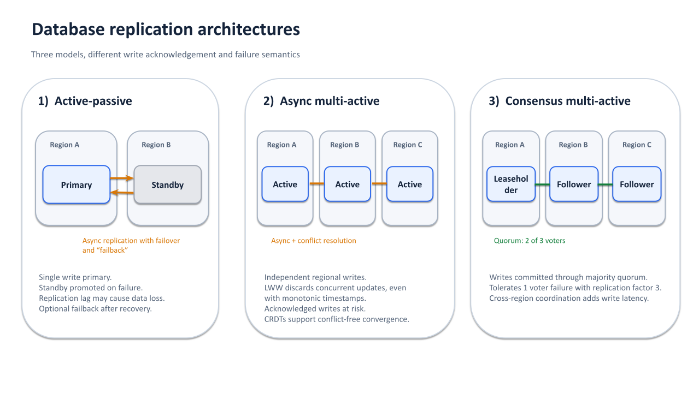

Several business drivers can justify adopting a multi-region deployment strategy:

- **Business continuity:** Maintain service availability during data centre or regional disruptions.
- **Customer experience:** Serve customers worldwide with predictable, low latency.
- **Scalability:** Adapt capacity to different markets and changing traffic volumes.
- **Regulatory compliance:** Address data residency, operational resilience, and concentration risk requirements.

None of this is free. A multi-region deployment typically costs more than a single-region one, and that cost has to be
weighed against the availability and performance it buys.

A multi-region deployment does not necessarily require a multi-active architecture. Traditional active-passive systems
can span multiple regions, with one serving production traffic and another standing by for disaster recovery.

Multi-active systems take a different approach. Multiple deployment sites serve production traffic simultaneously,
allowing geographically distributed infrastructure to contribute to normal operations rather than sitting idle until a
failure occurs.

## Multi-Active Systems

A multi-active system serves production traffic concurrently from multiple data centres or regions.

Workloads are distributed across deployment sites based on factors such as geographic proximity, capacity, and data
locality. Each site actively contributes to the production workload rather than acting exclusively as a standby
environment.

The term covers two different designs.

In the first, each site accepts writes independently and replicates them asynchronously, resolving conflicting changes
after the fact. Last-write-wins is a common conflict resolution strategy, but it is not information-preserving:
concurrent updates may be discarded even when successfully acknowledged. A site failure can also result in the loss of
acknowledged writes that have not yet been replicated.

In the second, database replicas coordinate through consensus before writes are acknowledged. This article focuses on
this model, where consensus-based replication provides the foundation for durability and transactional consistency.

If a data centre becomes unavailable, traffic can be redirected to other active sites. Since those sites already serve
production traffic, recovery does not require activating an entirely separate environment.

This does not mean failover disappears. Load balancers must detect failures, connections may be interrupted, and
stateful services may need to relocate ownership of resources. The difference is that these mechanisms are part of
normal system operation rather than a separate disaster recovery procedure.

Multi-active architectures can improve infrastructure utilization, but enough spare capacity must remain to absorb 
the workload of a failed site.

Assuming equally sized sites and evenly distributed workloads, two sites must each operate at no more than 
50% capacity to survive losing either one. With three sites, each can operate at roughly 67%.

### State and Consistency

Distributing stateless application services is relatively straightforward. Managing shared transactional state across
multiple locations is considerably harder.

Consider a financial transaction that transfers funds between two accounts. Regardless of which region processes the
request, the system must preserve account balances, apply the transfer atomically, and handle concurrent transactions
correctly.

Some of the challenges include:

- Preserving transactional invariants during concurrency and failures.
- Coordinating access to shared state across regions.
- Handling ambiguous transaction outcomes and retries.
- Preventing duplicate business effects during event processing.
- Managing replication, data locality, and consistency guarantees.

Applications can implement these mechanisms themselves, but delegating much of this responsibility to the database 
reduces application complexity.

Distributed SQL databases such as CockroachDB provide transactional consistency and consensus-based replication across
multiple failure domains. Applications can work with SQL transactions while the database manages replication,
concurrency control, and recovery from supported infrastructure failures.

Application-level concerns such as idempotency and transaction retries still need attention, but the database provides a
consistent foundation for shared transactional state.

### Consensus and Failure Tolerance

Consensus-based replication allows a group of replicas to agree on changes even when some replicas become unavailable.

For example, a three-voter consensus group distributed across three independent failure domains can tolerate the loss of
one voter while retaining a majority quorum. A five-voter group can tolerate two voter failures.

To tolerate the complete loss of any one failure domain while retaining a majority quorum, voting replicas must be
distributed across at least three independent failure domains. With only two regions, one must hold a majority of 
voting replicas. Losing that region makes the affected data unavailable.

However, deploying a database across three regions does not automatically mean it can survive the loss of any one
region.

Fault tolerance depends on replica placement, quorum requirements, and whether the remaining replicas can communicate.

CockroachDB, for example, supports both zone and region survival goals. Zone survival is the default and protects
against the loss of an availability zone. Region survival requires at least three regions and uses a replication
configuration designed to maintain quorum after losing a region.

A network partition has similar consequences. Nodes in an isolated region may continue running, but without access to a
quorum, they cannot make progress on writes or serve ordinary strongly consistent reads for the affected data. Active
does not mean autonomous.

Strong consistency also has a latency cost. Writes must be replicated to a majority of voting replicas, which can
introduce cross-region round trips depending on replica placement. Consistent reads are typically served by a designated
replica (the leaseholder, in CockroachDB) without a quorum round trip, but clients in other regions still pay the
network latency to reach it.

Careful data placement can reduce this overhead by keeping frequently accessed data close to the applications using it.

## Failover-Based Systems

To contrast multi-active systems, consider traditional **active-passive architectures**.

An active-passive system serves production traffic from a designated primary data centre or region. A secondary
environment maintains replicated data and sufficient infrastructure to take over if the primary becomes unavailable.

The architecture is typically designed around the assumption that one location owns the active workload.

During a disruption, recovery may involve promoting a secondary database, redirecting traffic, and ensuring the original
primary can no longer accept conflicting writes.

Once the disruption is resolved, operations may need to be transferred back to the original site.

This approach has several limitations:

- **Underutilized infrastructure:** Standby environments consume resources without necessarily contributing to
  production capacity.
- **Potential data loss:** Asynchronous replication can leave acknowledged writes missing from the secondary site, and
  they are lost if it is promoted.
- **Recovery time:** Promoting replicas and redirecting traffic takes time.
- **Operational complexity:** Failover procedures must account for incomplete replication, network partitions, and the
  risk of split-brain behavior.
- **Testing difficulties:** Disaster recovery procedures may be exercised infrequently, allowing configuration drift and
  hidden dependencies to accumulate.

These limitations are not universal. Active-passive systems can provide effective disaster recovery, particularly when
recovery requirements do not justify the complexity of a multi-active deployment.

However, multi-active architectures offer an alternative where resilience is built into normal production operations
rather than depending primarily on standby capacity and recovery procedures.

## Disaster Recovery Spectrum

The objective of a **disaster recovery** strategy is to minimize service disruption and data loss following a
significant failure.

Two common measures are:

- **Recovery Time Objective (RTO):** The maximum acceptable time required to restore service.
- **Recovery Point Objective (RPO):** The maximum acceptable amount of data loss, expressed as a period of time.

Both are targets set by the business. What an architecture delivers is the achieved recovery time and recovery point,
and the approaches below differ in what drives those.

Disaster recovery approaches range from backups to continuously operating multi-active deployments.

### Backups

Data is periodically backed up to separate infrastructure or cloud storage.

Recovery time depends on how long restoration takes, while the recovery point depends on backup frequency and
available recovery mechanisms, such as transaction log archiving.

Backups remain essential even for highly available systems because replication does not protect against logical
corruption or accidental deletion. It copies both faithfully.

### Cold Standby

A minimally provisioned secondary environment can take over after the primary fails.

Recovery may require provisioning infrastructure, restoring state, or starting application services. This reduces
infrastructure costs but generally results in longer recovery times.

When state is restored from backups, the recovery point is set by backup frequency, as above.

### Warm Standby

A secondary environment is maintained in a more operationally ready state, often scaled down and with continuously
replicated data.

Recovery is generally faster than with cold standby, at the expense of higher infrastructure costs.

### Hot Standby

A fully provisioned secondary environment runs continuously with replicated data and can take over with little
preparation. It often serves read-only workloads in the meantime.

Recovery is faster again, and the cost approaches that of a second production environment.

Wherever a standby is fed by replication, the recovery point depends on the replication strategy. Asynchronous
replication introduces potential data loss. Synchronous replication can eliminate the risk of losing acknowledged writes
under supported failure scenarios, at the price of coordination latency and potentially reduced availability.

### Multi-Active

Multiple deployment sites serve production traffic simultaneously.

When one site fails, surviving sites can continue processing workloads, provided they have sufficient capacity and
access to the required state.

Recovery time is not zero. Failure detection, the transfer of leadership for affected data, and client reconnects
typically take seconds, but no separate environment has to be activated.

With synchronous replication, an RPO of zero is achievable for acknowledged writes under supported failure scenarios.
Asynchronous replication provides no such guarantee.

Recovery beyond the system's fault tolerance may require accepting data loss. Backups remain necessary to recover from
logical corruption, operator mistakes, and more severe failures.

## Multi-Region Deployments

Distributing infrastructure across independent failure domains reduces exposure to individual infrastructure failures.
Multiple availability zones can protect against zone-level disruptions, while geographically separated regions can
extend resilience to regional failures.

However, an application deployed across several regions may still depend on a database or another critical service
hosted entirely within one region.

A resilient multi-region architecture must therefore account for the availability of its critical dependencies, not
just the application tier.

Multi-active systems address part of this challenge by allowing applications to serve requests from multiple regions
while a distributed database manages shared transactional state and replication.

The remaining trade-offs concern latency, data locality, regulatory requirements, and operational costs.

### Data Locality and Latency

Data placement is one way to manage the latency costs of geographic distribution.

Keeping region-specific data close to the applications and customers accessing it can reduce cross-region
communication.

For example, customer data associated with European operations might primarily reside in Europe, while North American
customer data is placed closer to North American workloads.

Globally shared data may require different placement and replication strategies.

Regulatory requirements can impose additional constraints. Data residency rules may restrict where information can be
stored or replicated, potentially limiting the options available for regional resilience.

CockroachDB provides multi-region capabilities for configuring data placement and survival requirements, allowing these
trade-offs to be managed at the database level.

### Multi-Cloud Resilience

Multi-region deployments within a single cloud provider may still be vulnerable to provider-wide failures or shared
infrastructure dependencies. Multi-cloud architectures can reduce this concentration risk by distributing workloads
across independent providers.

This is particularly relevant to UK financial institutions, where PRA regulations on operational resilience and
third-party risk management require banks to assess concentration risk and maintain critical services during
disruptions. Multi-cloud is not a regulatory requirement, but one possible strategy for addressing these concerns.

Operating across cloud providers introduces additional complexity, including network latency, data transfer costs, and
differences in managed services. Infrastructure portability and deployment flexibility become important considerations
when designing multi-active systems across clouds.

### Operational Considerations

Multi-active deployments reduce dependence on traditional failover procedures, but they introduce other operational
requirements.

Traffic routing must account for regional health and available capacity. Surviving regions need enough resources to
absorb displaced workloads.

External dependencies must also be considered. A multi-active application can still become unavailable if it relies on a
single-region identity provider, message broker, or integration service.

Finally, failure handling needs regular testing.

Regional isolation, interrupted transactions, replication failures, and recovery after network partitions should be
treated as expected operating conditions rather than exceptional scenarios.

## Conclusion

Multi-active architectures allow multiple deployment sites to serve production workloads concurrently, reducing
dependence on traditional failover procedures and, with enough sites, making better use of infrastructure capacity.

Combined with multi-region deployment and appropriate replication, they can improve resilience against regional
disruptions while bringing applications closer to geographically distributed customers.

The main challenges lie in managing shared state, transactional consistency, and data locality. Distributed databases
such as CockroachDB can address much of this complexity through consensus-based replication and transactional
guarantees.

The objective is not to eliminate infrastructure failures, but to design systems that can continue operating when those
failures occur.
