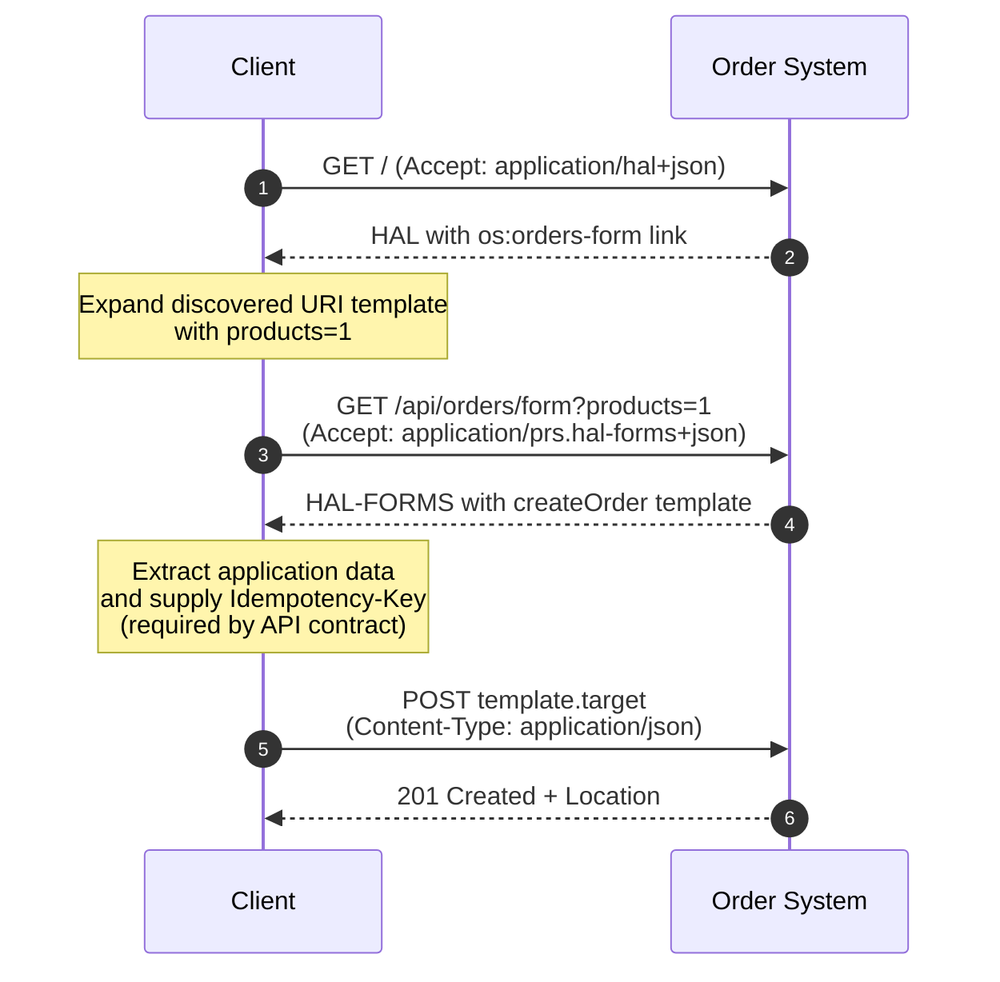
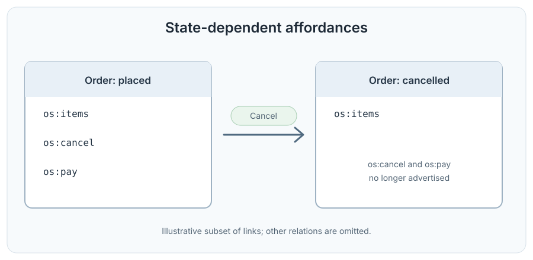

This article is the first in a series on REST API design, examining resource-oriented APIs, hypermedia, and the
distinction between REST and conventional HTTP APIs.



Most APIs described as RESTful expose resources through HTTP, use familiar methods such as GET, POST, PUT, and DELETE,
and return JSON representations. OpenAPI specifications document the available operations, while generated clients make
them straightforward to invoke.

This approach works well for many applications but it raises an architectural question worth examining:
**How much does a client need to know about the server to interact with it?**

Consider an order management API. A client can create an order, retrieve it, pay for it, cancel it, or mark it as delivered.

A generated Java client might expose methods such as:

```java
api.createOrder(request);
api.getOrder(orderId);
api.payOrder(orderId);
api.cancelOrder(orderId);
api.deliverOrder(orderId);
```

These methods provide a convenient, type-safe way to invoke operations. They also rely on predefined knowledge of the
API's operations and how to invoke them.

For example, an order might be cancellable only before payment. A client could determine eligibility from the order's
status, but that introduces a dependency on the server's business rules.

The server could instead communicate eligibility directly:

```json
{
  "status": "placed",
  "canCancel": true
}
```

This keeps the decision on the server. However, the client still needs to know which API operation performs cancellation
and how to invoke it.

What if the server could communicate both available interactions and their invocation details through a standardized
mechanism?

## Discovering and submitting an order



The [Order System](https://order-system.cloudneutral.se/) is a small example application built with Spring Boot and Spring
HATEOAS. It uses HAL to describe resource relationships and HAL-FORMS to describe available operations.
Rather than requiring clients to know the order submission endpoint in advance, the API exposes an entry point from which
resources and interactions can be discovered.

### Discovering the order form

A client begins by requesting the API root:

```shell
curl -i http://localhost:8090/ \
  -H 'Accept: application/hal+json'
```

The response advertises an order form through the `os:orders-form` relation:

```json
{
  "_links": {
    "os:orders-form": {
      "href": "http://localhost:8090/api/orders/form{?products}",
      "templated": true,
      "title": "Purchase order form"
    },
    "curies": [
      {
        "name": "os",
        "href": "https://order-system.cloudneutral.se/rels/{rel}",
        "templated": true
      }
    ]
  }
}
```

The example omits unrelated links. The `os` prefix is a CURIE, a compact URI used to identify application-specific 
link relations. It expands to a URI identifying the relation independently of the server's deployment location.

The `os:orders-form` link is also a URI template. Its `products` parameter determines how many product lines the generated
form should contain.

A client requesting a form with one product line follows the expanded URI:

```shell
curl -i 'http://localhost:8090/api/orders/form?products=1' \
  -H 'Accept: application/prs.hal-forms+json'
```

Notice that the client discovers the form's location rather than constructing its path.

### Submitting the form

The server returns an order form containing initial values and a HAL-FORMS template describing how to submit it.

The following excerpt shows the relevant properties:

```json
{
  "customerId": "0ce7d95f-437b-46ad-8fb1-b1378d8881a0",
  "items": [
    {
      "productId": "56b95a51-8227-489f-b5e6-834a2ffb849f",
      "quantity": 2
    }
  ],
  "_links": {
    "describedby": {
      "href": "http://localhost:8090/profiles/order-request"
    }
  },
  "_templates": {
    "createOrder": {
      "method": "POST",
      "contentType": "application/json",
      "properties": [
        {
          "name": "customerId",
          "required": true
        },
        {
          "name": "items",
          "required": true
        }
      ],
      "target": "http://localhost:8090/api/orders"
    }
  }
}
```

The template describes the HTTP method, submission target, content type, and expected properties.
The actual representation provides additional metadata, including constraints on `customerId` and a link for discovering
available customer selections. The `describedby` relation identifies a JSON Schema that describes the request structure 
and its constraints.

Using the method, content type, and target advertised by the HAL-FORMS template, the client can submit the form's application data:

```shell
curl -i -X POST 'http://localhost:8090/api/orders' \
  -H 'Content-Type: application/json' \
  -H 'Accept: application/hal+json' \
  -H 'Idempotency-Key: example-order-001' \
  -d '{
    "customerId": "0ce7d95f-437b-46ad-8fb1-b1378d8881a0",
    "items": [
      {
        "productId": "56b95a51-8227-489f-b5e6-834a2ffb849f",
        "quantity": 2
      }
    ]
  }'
```

The client submits the application data, not the entire HAL-FORMS representation.
The Order System also requires an `Idempotency-Key` header when placing an order. Reusing the same key for retries allows
the server to recognize repeated submissions of the same logical request rather than create duplicate orders.

This requirement is part of the API contract but isn't currently described by the HAL-FORMS template. The client must
obtain that knowledge separately. A successful submission returns `201 Created`, with a `Location` header identifying 
the new order resource. The client can then retrieve the created order or follow the links provided in its representation.

## Discovering available operations

Creating an order is only the beginning of the interaction. The server returns a HAL representation describing the newly
created resource and its relationships.

For example:

```http
HTTP/1.1 201 Created
Content-Type: application/hal+json
Location: http://localhost:8090/api/orders/5f213cd7-ce00-4338-9520-9fadc1267224
```

```json
{
  "status": "placed",
  "totalPrice": 166360.14,
  "_links": {
    "self": {
      "href": "http://localhost:8090/api/orders/5f213cd7-ce00-4338-9520-9fadc1267224"
    },
    "os:items": {
      "href": "http://localhost:8090/api/orders/5f213cd7-ce00-4338-9520-9fadc1267224/items"
    },
    "os:cancel": {
      "href": "http://localhost:8090/api/orders/5f213cd7-ce00-4338-9520-9fadc1267224/cancel"
    },
    "os:pay": {
      "href": "http://localhost:8090/api/orders/5f213cd7-ce00-4338-9520-9fadc1267224/payments"
    }
  }
}
```

The example omits unrelated properties and links. The `self` relation identifies the order resource, while `os:items`
identifies its line-item collection. The `os:cancel` and `os:pay` relations identify interactions currently available 
for the order.

In this API, the server advertises these relations according to the order's current state. This is an application-level
convention, not behavior enforced automatically by HAL.

### State-dependent affordances

Suppose the client wants to cancel the order. The presence of `os:cancel` tells it that cancellation is currently available, 
without requiring it to reproduce the server's eligibility rules. However, a HAL link alone doesn't specify the HTTP method 
or request content required to perform the operation.

The client can request the order using HAL-FORMS:

```shell
curl -i 'http://localhost:8090/api/orders/5f213cd7-ce00-4338-9520-9fadc1267224' \
  -H 'Accept: application/prs.hal-forms+json'
```

The representation includes a cancellation template:

```json
{
  "_templates": {
    "cancel": {
      "method": "POST",
      "properties": [],
      "target": "http://localhost:8090/api/orders/5f213cd7-ce00-4338-9520-9fadc1267224/cancel"
    }
  }
}
```

The client now has the information needed to invoke cancellation. The empty `properties` array indicates that the
operation requires no input properties.



There is a distinction between the `os:cancel` link relation and the `"cancel"` template key. HAL-FORMS does not
automatically associate the two identifiers. A client needs an API-specific convention to determine which template
corresponds to the advertised interaction.

Once the order is cancelled, the server no longer advertises the cancellation affordance. The same principle applies 
to other state-dependent operations. Their availability is determined by the server and communicated through the 
resource representation.

An advertised operation isn't a guarantee of success. State can change between retrieving the representation and
invoking the operation, so the server must still validate the request.

## REST's uniform interface

The workflow illustrates **hypermedia as the engine of application state**, commonly abbreviated HATEOAS.
Hypermedia is one of REST's defining architectural constraints, although it is frequently absent from APIs described
as RESTful. 

REST's uniform interface encompasses resource identification, manipulation through representations,
self-descriptive messages, and hypermedia-driven application state. The last of these changes how clients interact with
servers. Rather than relying entirely on predefined endpoint knowledge, clients discover available interactions through 
resource representations.

In the Order System, the client discovers the order form, submits it using an advertised template, follows the resulting
resource, and discovers the operations available in its current state.

## Why standardized controls matter

A server can communicate available operations without using hypermedia. A conventional API might expose `canCancel`
or `allowedActions`, leaving the client to map those capabilities to predefined HTTP requests.

HAL-FORMS provides a standardized representation for describing how an operation can be invoked, including its method,
target, and input properties. A reusable client component can interpret these controls and construct requests without
knowing the target URI in advance. The application still needs to understand the operation's meaning and decide whether 
to invoke it.

**Hypermedia doesn't eliminate coupling. It can reduce it by separating domain semantics from interaction mechanics.**

This doesn't make OpenAPI or generated clients obsolete. OpenAPI describes API contracts and supports documentation,
validation, and code generation. HAL and HAL-FORMS provide controls within resource representations at runtime.

## What hypermedia doesn't solve

An automated hypermedia-driven client isn't equivalent to a web browser client. A browser can display an unfamiliar form
and rely on a human to interpret it. An automated application cannot generally understand an unfamiliar business operation 
simply because the server advertises it. 

The Order System illustrates some of the remaining dependencies. Clients need to understand application-specific link
relations and template conventions. They must also know about requirements not expressed in the representation, such
as the `Idempotency-Key` header used when creating orders.

And although the server advertises operations according to the resource's current state, that state can change before
a client submits its request. A client might retrieve an order with an `os:cancel` link, only for another request to
change the order's state before cancellation is submitted. The server must evaluate the cancellation rules again rather 
than treating the previously advertised link as authorization to proceed.

In [Reducing REST Client-Server Coupling](),
we'll examine how changes to business rules and interaction details affect clients, and which dependencies runtime-discovered 
controls can reduce.
