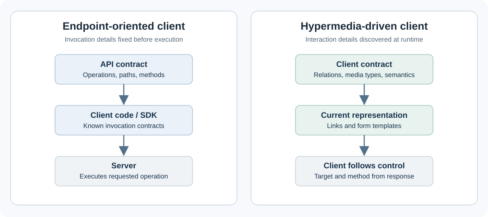
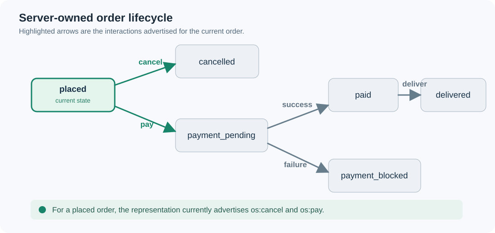
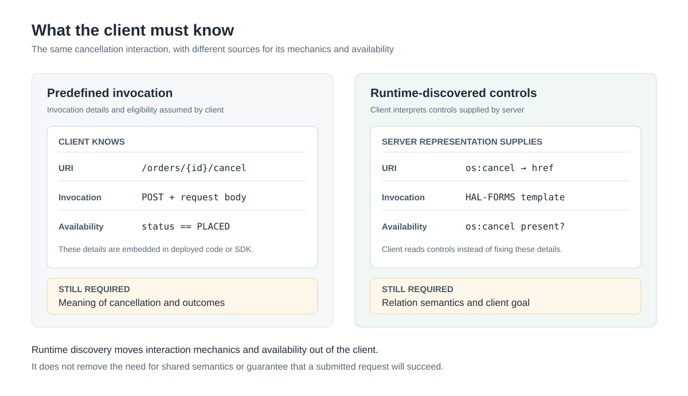
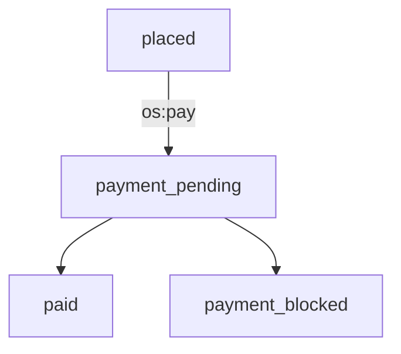

This article is part of a series on REST API design, examining how runtime-discovered interactions reduce client-server
coupling and accommodate evolving workflows.



Suppose a client retrieves an order:

```http
GET http://localhost:8090/api/orders/8e2f3a91-6d47-4c8b-9e13-2a7b5c0d4f62
```

```json
{
  "status": "placed",
  "totalPrice": 149.00
}
```

We know the order's state, but can we cancel it or pay for it? Where are its items, and what request performs 
each operation?

A conventional client developer learns these details from documentation, an OpenAPI description, or a generated SDK. The
client's application code might look like this:

```java
Order order = api.getOrder(orderId);

if (order.status() == PLACED) {
    api.cancelOrder(orderId);
}
```

This client embeds an eligibility assumption: an order in the placed state can be cancelled. It also relies on a
predefined operation for submitting the cancellation request. Suppose the business introduces a cancellation deadline:
orders may now be cancelled only within 30 minutes of placement. The client-side condition is wrong, and consumers that
copied the rule need attention.

A server-computed `canCancel` property solves that problem without hypermedia:

```java
Order order = api.getOrder(orderId);

if (order.canCancel()) {
    api.cancelOrder(orderId);
}
```

The server now owns the eligibility rule, but the client still needs to know how to invoke cancellation.

In a typical OpenAPI-generated SDK, `cancelOrder()` is bound to a predefined HTTP method, URI template, and request
contract. Those details are hidden from application code, but they remain part of the deployed client.

If the server removes or incompatibly changes the operation, consumers must update their SDKs or rely on a compatibility
mechanism. Updating the SDK may leave application code unchanged, but consumers still need to adopt, test, and deploy it.

The limitation is not inherent to generated code. An SDK can expose strongly typed operations while resolving invocation
details at runtime. The distinction is whether those details are embedded in the client or obtained from the server.

Across many independently deployed consumers, even a small change can introduce coordination and compatibility costs.

Hypermedia offers another option: communicate available interactions and their invocation details through resource
representations, allowing clients to discover them at runtime.

## Shared understanding: design time and runtime

Every API requires a shared contract. Clients must understand the data they receive, the meaning of the operations they
perform, and the conventions used to communicate with the server.

In a typical operation-oriented client, invocation details are established before execution. A hypermedia-aware client
can instead resolve supported interaction details from resource representations at runtime.



*Clients with predefined invocation contracts bind request details before execution. Hypermedia-aware clients can discover
interaction targets and submission details at runtime. Both approaches still require shared semantics.*

OpenAPI provides a mature foundation for describing operations and schemas, generating strongly typed clients, and
validating integrations before deployment.

HAL and HAL-FORMS serve a different purpose. They standardize how links and submission controls are represented, but do
not provide an equivalent, complete API description from which conventional typed clients can be generated.

The two approaches can be combined. An API might use OpenAPI to document its domain models and supported interactions,
while using hypermedia to communicate which interactions are currently available and how to invoke them.
A client can retain generated domain models and strongly typed operations while resolving targets and submission details
dynamically.

The distinction is between **what the client must understand in advance** and **what the server communicates at runtime**.

## From resource state to available interactions

A resource representation normally describes the resource's current state. With hypermedia, it can also communicate the
interactions currently available.

In the Order System, an order in the `placed` state can advertise links such as:

```json
{
  "status": "placed",
  "totalPrice": 149.00,
  "_links": {
    "self": {
      "href": "http://localhost:8090/api/orders/8e2f3a91-6d47-4c8b-9e13-2a7b5c0d4f62"
    },
    "os:items": {
      "href": "http://localhost:8090/api/orders/8e2f3a91-6d47-4c8b-9e13-2a7b5c0d4f62/items"
    },
    "os:cancel": {
      "href": "http://localhost:8090/api/orders/8e2f3a91-6d47-4c8b-9e13-2a7b5c0d4f62/cancel"
    },
    "os:pay": {
      "href": "http://localhost:8090/api/orders/8e2f3a91-6d47-4c8b-9e13-2a7b5c0d4f62/payments"
    }
  }
}
```

This abbreviated HAL representation contains resource data and links to related resources. The `os:cancel` and `os:pay`
relations identify interactions offered for this order. The `os:` prefix is a HAL CURIE prefix, expanded through a relation
URI template omitted here for brevity.

The client does not have to infer cancellation eligibility from `status == placed`. It can inspect whether the cancellation
interaction is advertised.

A HAL link alone does not specify the HTTP method or request body required for a state-changing operation.

With `Accept: application/prs.hal-forms+json`, the server can additionally provide a HAL-FORMS template:

```json
{
  "_templates": {
    "cancel": {
      "method": "POST",
      "target": "http://localhost:8090/api/orders/8e2f3a91-6d47-4c8b-9e13-2a7b5c0d4f62/cancel",
      "properties": []
    }
  }
}
```

The client can obtain the submission details from the template, provided it knows how to select the appropriate one.
HAL-FORMS does not define a general association between link relations and template names.

### Resource state and application state

The order's `status` is part of its resource state, which the server manages. A representation exposes selected information
about that state.

**Application state** concerns the client's progression through interactions with the application. The client maintains
that state, while representations provide hypermedia controls that guide its next steps.

For example, a client viewing a `placed` order can follow `os:items` to inspect its items, then navigate back to the order.
The client has progressed through the application, but the order can remain `placed` throughout.

Following `os:items` changes the client's navigation state without modifying the order. Submitting the cancellation form
instead requests a resource-state change, which the server may accept or reject.

The order's lifecycle can be modeled as a finite-state machine. That is a server-managed resource lifecycle, **not the
client's application state machine**. A client can navigate through the application without reproducing every transition 
in the server's resource lifecycle.



*The server governs the order lifecycle. For a `placed` order, the representation advertises `os:cancel` and `os:pay`.
Following `os:items` changes the client's navigation state without changing the order's lifecycle state. The diagram
simplifies payment outcomes and other workflow details.*

## Discoverability is a form of decoupling

Starting from an API entry point, a client can follow named relationships and inspect the interactions offered by each
representation. Information discovered at runtime does not have to be embedded in every client. The degree of decoupling 
depends on which details the server provides and which the client actually uses.



### URI coupling

A client following `os:cancel` does not need to construct or hardcode the cancellation URI.

Suppose the Order System changes its cancellation endpoint:

```text
Before:
POST http://localhost:8090/api/orders/{id}/cancel

After:
POST http://localhost:8090/api/orders/{id}/cancellation
```

The operation still has the same meaning and accepts the same inputs. Only its URI has changed.
Clients with `/cancel` embedded in their invocation logic continue working while the old endpoint remains supported. 
If the server removes it, those clients must update or rely on a compatibility mechanism.
This applies to handwritten clients and generated SDKs with fixed URI templates.

A client that discovers the cancellation target from the current representation can use `/cancellation` without changing
its code, provided it reaches the order through a stable entry point or previously discovered link.

### Invocation coupling

URI independence does not imply independence from invocation details. A client might discover `os:cancel` but still 
assume cancellation requires a `POST` request with a particular body.

HAL-FORMS can reduce this dependency by describing the submission method, target, and input properties at runtime.
There are limits. If the server adds a mandatory cancellation reason, a generic interactive client might render the new
field and collect a value. An automated client cannot necessarily determine which reason is appropriate.

Likewise, changing an HTTP method may affect semantics. A client must support the method and understand the interaction
it performs.

### Workflow coupling

A client may know how to invoke every operation but still assume the server follows a particular sequence of states and
transitions. It might assume that an order can always be paid when its status is `placed`, for example.

Advertised controls let the client check which interactions are currently available rather than infer them entirely from
resource state. This does not tell the client which interaction advances its goal, whether an unavailable interaction 
might become available later, or how to recover when no suitable interaction is offered.
Those decisions remain part of the client's application logic.

### What remains coupled?

A client following `os:cancel` still depends on the meaning of cancellation, the expected outcomes, and the conventions
used to interpret the representation. It need not know the cancellation URI in advance. With suitable HAL-FORMS processing,
it can also discover supported submission details.

Hypermedia therefore reduces coupling to **server-controlled interaction mechanics and availability**, not to the shared
meaning of interactions or the client's business requirements.

## Evolving workflows without rewriting clients

Consider a client that embeds part of the server's payment workflow:

```java
switch (order.status()) {
    case PLACED -> api.pay(orderId);
    case PAYMENT_PENDING -> api.checkPayment(orderId);
    case PAYMENT_BLOCKED -> handlePaymentFailure(order);
    default -> handleUnexpectedState(order);
}
```

The client associates particular resource states with predefined operations.

Initially, the payment workflow looks like this:



The client assumes that payment begins in the `placed` state and that a `payment_pending` order should be checked until
payment completes or fails.

Suppose the server no longer offers payment immediately for every `placed` order. The order may remain `placed` while
the server determines whether payment can proceed. Once payment becomes available, the representation advertises `os:pay`.

The interaction has not changed, but its availability has. A client relying on `PLACED -> pay` may attempt payment
prematurely.

But what happens when `os:pay` is absent?
The client may need to refresh the representation, follow another advertised interaction, report that payment is
unavailable, or stop processing. Which behavior is appropriate depends on the application's goal and contract.

Hypermedia communicates interaction availability. It does not automatically provide a waiting or recovery strategy.
The distinction becomes important when workflows evolve. Changing the availability or ordering of known interactions can
be compatible with existing clients. Introducing a mandatory interaction with unfamiliar semantics may require new client
logic, even if the server advertises it through hypermedia.

### Couldn't OpenAPI do the same?

Yes. A conventional API can expose capability flags or available actions:

```json
{
  "status": "placed",
  "allowedActions": [
    "pay"
  ]
}
```

OpenAPI does not prevent an API from exposing available actions, interaction targets, or submission metadata. HAL and
HAL-FORMS provide established conventions for representing those controls.

## The economics of independent evolution

Preserving the old endpoint may still be cheaper than introducing hypermedia. Endpoint renaming alone is not a
compelling reason to adopt it.

The more interesting case is an API with many independently maintained consumers and interactions that evolve over time.
Compatible changes to interaction targets, submission mechanics, or the availability of known operations can sometimes be
made without coordinating consumer releases.

Compatibility depends on the client's existing capabilities, not merely on what the server advertises.
The economic benefit depends on the frequency of those changes, the number of affected consumers, and the cost of
coordinating their releases.

## The cost of runtime flexibility

Runtime discovery shifts some responsibilities from design time to execution. Clients must understand HAL and HAL-FORMS
processing conventions, while domain-specific relation semantics still need documentation.

There are testing implications too. A client that discovers controls dynamically must be tested against representations 
with different combinations of available interactions, including missing, unfamiliar, and changing controls.

Some mistakes that predefined operations might expose during compilation or contract testing may instead surface when a
particular runtime interaction is encountered.

The additional flexibility must justify the additional client infrastructure.

For a small API with stable operations and easily updated consumers, predefined invocation contracts may be simpler. For
a long-lived API with independently deployed consumers, reducing coordinated client releases may justify the investment.

## It takes two to tango

Hypermedia only reduces coupling when clients actually follow the controls the server provides.
A server can return HAL links and HAL-FORMS templates, but clients that ignore them remain dependent on their predefined
request targets and workflow assumptions.

Following the controls also does not guarantee that an interaction will succeed. Suppose a client retrieves a `placed`
order and sees `os:cancel`. Before it submits the cancellation form, another request changes the order so that 
cancellation is no longer permitted.

The client submits the previously advertised request:

```http
POST http://localhost:8090/api/orders/8e2f3a91-6d47-4c8b-9e13-2a7b5c0d4f62/cancel
```

The server may respond:

```http
HTTP/1.1 409 Conflict
```

The client followed the advertised interaction correctly, but the server rejected the request because 
cancellation was no longer permitted. The client may need to retrieve the current representation before 
deciding what to do next.

The server must enforce authorization and revalidate business rules when processing the request. 
An advertised control is therefore not an authorization or execution guarantee.

Hypermedia does not eliminate concurrency problems, retries, or network failures. It changes how clients discover and
invoke interactions, not the guarantees required to execute them safely.
