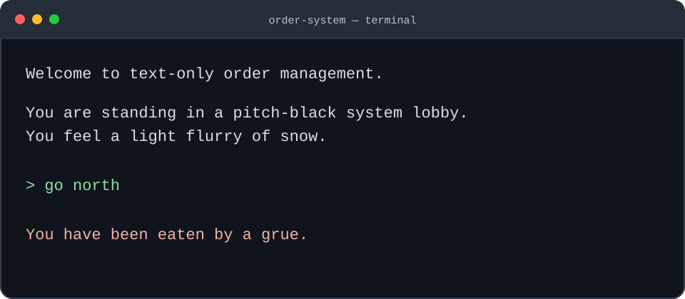
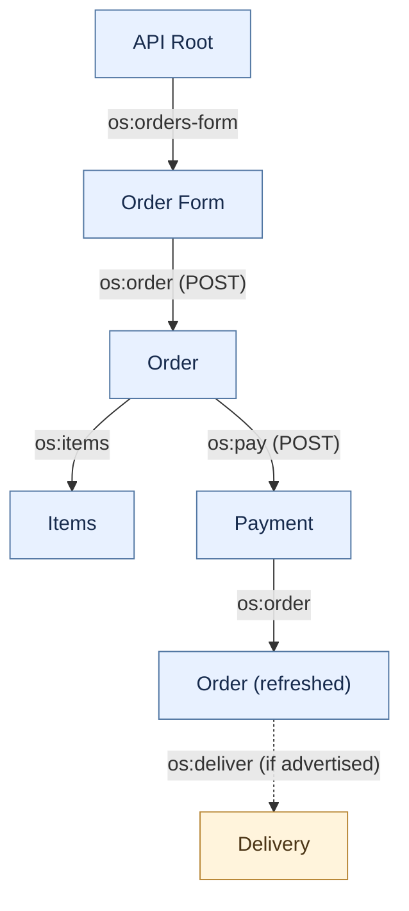
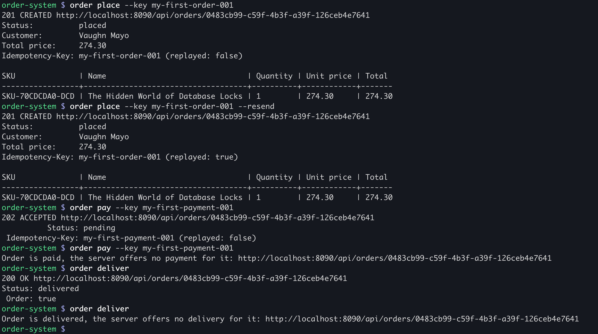

This article is part of a series on REST API design, demonstrating how a client can discover and follow HAL links and
submit HAL-FORMS templates using the Order System implementation.



I have the API root at `http://localhost:8090/`, but no list of endpoints to work from.

Suppose I'm tasked with building a client for an [order management API](https://order-system.cloudneutral.se/) 
I've never seen before. The requirements are fairly straightforward, at least on paper: 
support placing orders, inspecting their contents, taking payments, and initiating delivery.

I understand the business domain well enough. Orders contain products, payment precedes delivery, and cancellation
is probably possible under certain conditions. What I don't know is how this particular API implements those
operations.

Normally, I'd start with an OpenAPI specification, find the relevant operations, and generate a Java client.
That would give me strongly typed request and response models and methods for invoking the API.

The Order System takes a different approach. It exposes a hypermedia API using HAL and HAL-FORMS.

I've worked with REST APIs before, but haven't built many clients that actually follow hypermedia controls.
And this is all due in two weeks.

This reminds me a little of Zork. You start somewhere unfamiliar, look around, and figure out which directions you can
go. Sometimes you go north when you shouldn't.



Hopefully, this API is a little more forgiving.

## Where do I start?

I'll just start with `curl` and see what the server tells me.

```bash
curl -i \
  -H 'Accept: application/hal+json' \
  http://localhost:8090/
```

The response contains links to resources and interactions available from the entry point. One of them looks
promising:

```json
{
  "_links": {
    "os:orders-form": {
      "href": "http://localhost:8090/api/orders/form{?products}",
      "templated": true,
      "title": "Purchase order form"
    },
    "curies": [
      {
        "name": "os",
        "href": "https://order-system.cloudneutral.se/rels/{rel}",
        "templated": true
      }
    ]
  }
}
```

There's no `createOrder()` method to call. Instead, the API advertises a relation named `os:orders-form`.

The `os` prefix is defined by a CURIE, allowing application-specific relation URIs to be represented in abbreviated
form. The Java client uses the full relation URI, `https://order-system.cloudneutral.se/rels/orders-form`, and resolves
it against the CURIEs advertised by the server. It doesn't depend on the `os` abbreviation.

The link's title suggests this is where I should go to create an order. Its URI contains `{?products}`, a URI-template 
expression. For demonstration purposes, the Order System lets me specify how many product lines the generated order 
form should contain. 

I'll request a form with just one product line to keep the example simple.

```bash
curl -sS \
  -H 'Accept: application/prs.hal-forms+json' \
  -o order-form.json \
  'http://localhost:8090/api/orders/form?products=1' && cat order-form.json  
```

I'm requesting HAL-FORMS rather than HAL because I want to discover how to submit the order, not just where the
form lives. For now, I've expanded the URI template manually and copied the resulting address into `curl`. 
The Java client will need to handle that itself.

## How do I submit the order?

The response contains application data, including a customer and product lines. It also contains `_templates`, which
describes how to submit the form. Here's the relevant part of the representation.

```json
{
  "customerId": "0ce7d95f-437b-46ad-8fb1-b1378d8881a0",
  "items": [
    {
      "productId": "56b95a51-8227-489f-b5e6-834a2ffb849f",
      "quantity": 2
    }
  ],
  "_links": {
    "os:order": {
      "href": "http://localhost:8090/api/orders"
    },
    "describedby": {
      "href": "http://localhost:8090/profiles/order-request"
    },
    "curies": [
      {
        "href": "https://order-system.cloudneutral.se/rels/{rel}",
        "name": "os",
        "templated": true
      }
    ]
  },
  "_templates": {
    "createOrder": {
      "method": "POST",
      "contentType": "application/json",
      "properties": [
        {"name": "customerId", "required": true},
        {"name": "items", "required": true}
      ],
      "target": "http://localhost:8090/api/orders"
    }
  }
}
```

Now I know considerably more about the API!



The `createOrder` template tells me to use `POST`, where to send the request, which content type to use, and
which properties are expected.

I'll extract the application data into a request body, leaving out the hypermedia metadata.

```bash
jq 'del(._links, ._templates)' order-form.json > order.json && cat order.json
```

Then submit it using the method and target advertised by the template.

```bash
curl -sS \
  -X "POST" \
  "http://localhost:8090/api/orders" \
  -H "Content-Type: application/json" \
  -H 'Accept: application/hal+json' \
  -d @order.json | jq
```

That didn't work.

```json
{
  "detail": "Placing an order requires an 'Idempotency-Key' header identifying the attempt",
  "instance": "/api/orders",
  "status": 400,
  "title": "Idempotency key required",
  "type": "https://order-system.cloudneutral.se/problems/idempotency-key-required"
}
```

Apparently, the Order System requires an `Idempotency-Key` header when creating orders. HAL-FORMS doesn't provide a
mechanism for describing required HTTP request headers, so this requirement isn't discoverable from the submission
template.

The error identifies the missing requirement, but doesn't explain how to generate or manage idempotency
keys. The application's [API contract](https://order-system.cloudneutral.se/guides/create-order/) 
explains how idempotency keys are scoped and reused.

I'll choose a key for this order creation attempt and try again.

```bash
curl -sSv \
  -X "POST" \
  "http://localhost:8090/api/orders" \
  -H "Content-Type: application/json" \
  -H 'Accept: application/hal+json' \
  -H 'Idempotency-Key: my-first-order-001' \
  -d @order.json | jq
```

Success!

```shell
< HTTP/1.1 201 Created
< Date: Fri, 13 Nov 2026 12:00:00 GMT
< Location: http://localhost:8090/api/orders/0e9d2ce1-3604-4894-9329-0fd14eb78170
< Idempotency-Replayed: false
< Content-Type: application/hal+json
< Transfer-Encoding: chunked
```

## Time to write some code

I now know enough about the Order System to create an order manually. But I need an interactive client that can do the
same without hardcoding the API's endpoint structure.

I'll use Java and Spring Shell for the interactive client.

I spend some time reading the HAL and HAL-FORMS specifications and looking through Spring HATEOAS.

Spring's `RestClient` handles HTTP requests. Spring HATEOAS provides URI-template expansion, and Jackson handles JSON
processing. I still need to resolve links and CURIEs, interpret HAL-FORMS templates, and represent the resources
returned by the server.

After some experimentation, I have a [baseline client](https://github.com/kai-niemi/order-system/tree/main/order-system-client)
built around a few classes:

- `HypermediaClient` handles HTTP requests and submissions.
- `Representation` provides access to links, application properties, and HAL-FORMS templates.
- `Template` holds the HTTP method, content type, and target advertised by a submission template.
- `OrderSystemRels` defines the application-specific relations the client understands.

It's not a general-purpose HAL-FORMS client. I've implemented enough to work with the Order System's representations
and the interactions I need. 

Let's see if I can place that order again, this time using my Java client.

I'll start by retrieving the API root and following `os:orders-form` to get the order form.

```java
Link formLink = client.root().link(OrderSystemRels.ORDERS_FORM)
        .orElseThrow(() -> new IllegalStateException(
                "API root has no order form link"));

Representation form = client.get(
        formLink.expand(Map.of("products", 1)),
        HypermediaClient.HAL_FORMS_JSON);
```

`OrderSystemRels.ORDERS_FORM` identifies the relation the application understands. The client resolves it against
the representation and expands the advertised URI template using `products=1`.

Now I need to submit the form. I could hardcode `POST /api/orders`, since I've already discovered that endpoint,
but that would defeat the purpose of building this client.

### Interpreting the submission template

The order form contains the `createOrder` template I discovered earlier. It describes the HTTP method, content
type, target URI, and properties expected by the server.

The baseline client uses a small `Template` record to hold the invocation details:

```java
public record Template(
        String name,
        String method,
        String contentType,
        String target) {
}
```

For now, I'm only interested in the information needed to submit a request. The record doesn't capture the
HAL-FORMS property definitions.

HAL-FORMS allows `target` and `contentType` to be omitted. The client applies the specification's defaults when 
constructing the `Template`: the representation's `self` URI for `target` and `application/json` for `contentType`.

The `HypermediaClient` uses the template when constructing the request:

```java
RestClient.RequestBodySpec request = restClient
        .method(HttpMethod.valueOf(template.method()))
        .uri(URI.create(template.target()));

if (body != null) {
    request.contentType(MediaType.parseMediaType(template.contentType()))
            .body(body);
}
```

That handles the HTTP invocation, but there's still a problem.

The representation can contain several templates. I know I want to create an order, but how does the client
identify the template associated with that interaction?

### Finding the right template

The order form advertises an `os:order` relation and a HAL-FORMS template named `createOrder`.

The names don't match. I could select the template by its name, but that would mean the application needs to
know both the link relation and the template name.

Looking at the [representation](#how-do-i-submit-the-order), I notice that the `os:order` link and the `createOrder` template point to the
same URI. I can use that to associate them.

```java
public Optional<Template> templateFor(Link link) {
    return templates().stream()
            .filter(template -> template.target().equals(link.getHref()))
            .findFirst();
}
```

Now the order command can find the submission template using the relation it already understands:

```java
Link orderLink = form.link(OrderSystemRels.ORDER)
        .orElseThrow();

Template template = form.templateFor(orderLink)
        .orElseThrow();
```

The command doesn't need to know the template's name.

There is a catch, though. HAL-FORMS doesn't define this association between link relations and templates. I'm
relying on a convention used by the Order System, where the link and template advertise the same target URI.

The comparison also uses exact string equality. It won't recognize equivalent URIs written differently, and
it becomes ambiguous if several templates share the same target. For the interactions implemented by this client, 
it works. But I wouldn't put this into a general-purpose HAL-FORMS client without reconsidering how templates are selected.

There's another shortcut in the implementation.

The Order System provides a populated form containing the application data needed to create an order. Rather
than processing every property definition in the HAL-FORMS template, I take that data and remove the hypermedia
metadata.

```java
if (!(body instanceof ObjectNode objectNode)) {
    // No content, or a body that isn't a JSON object
    return body;
}
ObjectNode state = objectNode.deepCopy();
state.remove(List.of("_links", "_templates"));
return state;
```

This is what `Representation.properties()` does. It returns the application data without `_links` and `_templates`, just
as I extracted it manually using `jq` earlier.

It also means the client doesn't validate the request body against the template's property definitions or
restrict it to the advertised properties. It assumes the populated form contains data suitable for submission.

That's sufficient for this Order System interaction, but it isn't a complete HAL-FORMS form processor.

### Submitting the order

I now have the submission template and the request body. The remaining detail is the `Idempotency-Key` header
I discovered earlier.

The Order System scopes idempotency keys to the authenticated principal, or to a shared anonymous scope when there's no
authentication. A UUID isn't required, so I'll use a readable key for this example. 
Retrying the same attempt requires reusing the original submission, including its template, request body, and
idempotency key. A new attempt needs a different key within the same scope.

These fixed keys are only for the local example. A client making new attempts against a shared deployment needs to
generate distinct keys.

```java
String idempotencyKey = "order-request-1";

Response response = client.submit(
        template,
        form.properties(),
        Map.of("Idempotency-Key", idempotencyKey));
```

The order command supplies the populated form data and the application-specific header. The submission method
and target URI come from the template.

Let's see what the server returns.

## The order exists. Where did it go?

The server responds with `201 Created`, along with an `Idempotency-Replayed` header indicating whether the
request created a new order or returned an existing one. Either way, I have an order to work with.
The response contains a `Location` header and an order representation.

```json
{
  "status": "placed",
  "totalPrice": 166360.14,
  "_links": {
    "self": {
      "href": "http://localhost:8090/api/orders/5f213cd7-ce00-4338-9520-9fadc1267224"
    },
    "os:items": {
      "href": "http://localhost:8090/api/orders/5f213cd7-ce00-4338-9520-9fadc1267224/items"
    },
    "os:cancel": {
      "href": "http://localhost:8090/api/orders/5f213cd7-ce00-4338-9520-9fadc1267224/cancel"
    },
    "os:pay": {
      "href": "http://localhost:8090/api/orders/5f213cd7-ce00-4338-9520-9fadc1267224/payments"
    },
    "curies": [
      {
        "href": "https://order-system.cloudneutral.se/rels/{rel}",
        "name": "os",
        "templated": true
      }
    ]
  }
}
```

The order is `placed`, and the server currently offers payment and cancellation. Before doing either, I want to inspect what was ordered.
There's an `os:items` relation, so I'll follow it.

```java
Representation order = response.representation();

Representation items = client.follow(order, OrderSystemRels.ITEMS);
```

The `follow()` method resolves the relation against the representation and retrieves the linked resource.

The order's `self` link identifies the same resource as the Location header. I'll use the link from the representation 
to retrieve the order later.

```java
URI orderUri = URI.create(
        order.link(IanaLinkRelations.SELF)
                .orElseThrow()
                .getHref());
```

The interactive client still needs to retain that URI between commands or let me select an existing order.

Now I need to get it paid and delivered.



## How do I get this order delivered?

The order representation advertises an `os:pay` relation. That tells me payment is currently available.

I could check whether the order's status is `placed`, but that would mean encoding the server's workflow rules in the
client. That's the coupling I'm trying to avoid.

```java
Representation order = client.get(
        orderUri,
        HypermediaClient.HAL_FORMS_JSON);

Link paymentLink = order.link(OrderSystemRels.PAY)
        .orElseThrow(() -> new IllegalStateException(
                "Payment is not available for this order"));

Template template = order.templateFor(paymentLink)
        .orElseThrow();
```

I'm retrieving the order as HAL-FORMS because I need the submission template, not just the navigational link.

Payment is a separate operation, so I'll use a different idempotency key.

```java
String idempotencyKey = "pay-request-001";

Response response = client.submit(
        template,
        null,
        Map.of("Idempotency-Key", idempotencyKey,
                "X-Simulate-Timeout", "no"));
```

The payment request doesn't require a body. The `Idempotency-Key` and `X-Simulate-Timeout` headers are specific
to the Order System, not HAL-FORMS. The timeout header is part of the application's testing support.

```json
{
  "id": "429f80d0-9115-4296-addb-7b5c25b03c04",
  "status": "pending",
  "_links": {
    "self": {
      "href": "http://localhost:8090/api/orders/5f213cd7-ce00-4338-9520-9fadc1267224/payments/429f80d0-9115-4296-addb-7b5c25b03c04"
    },
    "os:order": {
      "href": "http://localhost:8090/api/orders/5f213cd7-ce00-4338-9520-9fadc1267224"
    },
    "curies": [
      {
        "href": "https://order-system.cloudneutral.se/rels/{rel}",
        "name": "os",
        "templated": true
      }
    ]
  }
}
```

The payment is `pending`. The representation also advertises `os:order`, linking back to the order being paid.

The payment status tells me something about the payment, but not which interactions are available on the order. 
I still need to discover those from the server.

There's no notification mechanism advertised for the payment's outcome. The payment's `self` link gives me a way to
retrieve its current representation, so polling is one option. The baseline client doesn't implement that yet.

I'll just retrieve the order again and check whether the server advertises `os:deliver`.

```java
Representation payment = response.representation();

Link orderLink = payment.link(OrderSystemRels.ORDER)
        .orElseThrow();

Representation updatedOrder = client.get(
        orderLink,
        HypermediaClient.HAL_FORMS_JSON);

boolean canDeliver = updatedOrder
        .link(OrderSystemRels.DELIVER)
        .isPresent();
```

That tells the interactive client whether the server currently advertises delivery.
When I choose to deliver the order, the command retrieves the current representation and checks the relation
again.

```java
Representation order = client.get(
        orderUri,
        HypermediaClient.HAL_FORMS_JSON);

Link deliveryLink = order.link(OrderSystemRels.DELIVER)
        .orElseThrow(() -> new IllegalStateException(
                "Delivery is not available for this order"));

Template template = order.templateFor(deliveryLink)
        .orElseThrow();

Response response = client.submit(template, null, Map.of());
```

Unlike order creation and payment, the Order System doesn't require an `Idempotency-Key` header for delivery.

The order might have changed since I submitted the payment. Retrieving the representation again gives me the server's
current view of which interactions are available.

## What happens when things go wrong?

The client can discover and submit the interactions advertised by the server. But what happens when a request fails, its
outcome is uncertain, or an interaction is no longer available?

[](shell-demo.png)

The `--resend` option lets me repeat the original order submission using the same request and idempotency key. I can
also supply a different key to submit the same payload as a new attempt, or reuse an existing key with a newly generated
form. These options aren't strictly necessary for the client, but they let me test how the Order System handles
idempotency and conflicting requests.

The repeated payment and delivery commands behave differently. Unlike order creation, they don't retain their previous
submissions for retrying. Instead, each invocation retrieves the current order representation and checks whether the
server still advertises the requested interaction. If the relation is absent, no request is submitted.

This becomes a limitation when the outcome of a request is uncertain. If a payment succeeds but its response is lost,
the client might find that `os:pay` is no longer advertised. Because the payment command doesn't retain the original
submission, it has nothing to retry, even with the same idempotency key.

The absence of `os:pay` tells the client that payment isn't currently advertised. It doesn't tell the client why.

I could inspect the order's `status` property and try to work out what's happening, but that brings me back
to encoding the server's workflow rules in the client. That's what I wanted to avoid.

The same applies to delivery. If `os:deliver` isn't present, the command can report that delivery isn't
currently available. It can't necessarily explain why or suggest what to do instead.

There's another problem. An advertised interaction might become unavailable between retrieving the
representation and submitting the request.
Following a link or submitting a template doesn't guarantee success. The server still validates the request
against its current state.

The baseline client reports HTTP errors through a `ProblemException`. It doesn't automatically retrieve the
resource again and look for another interaction.

For an interactive shell, that's a reasonable boundary. I can inspect the current representation and decide
what to do next.

But it leaves an interesting question. If the server stops advertising `os:pay`, should the client simply report that payment isn't available, or
should it interpret the order's properties to explain why?
