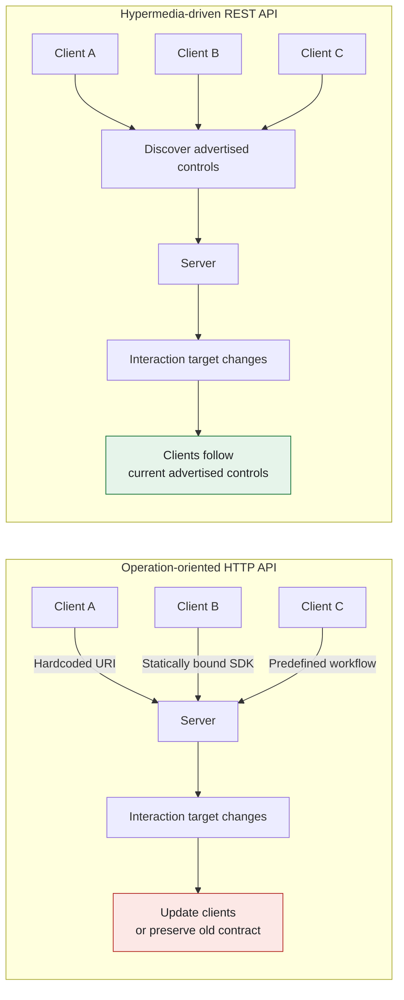
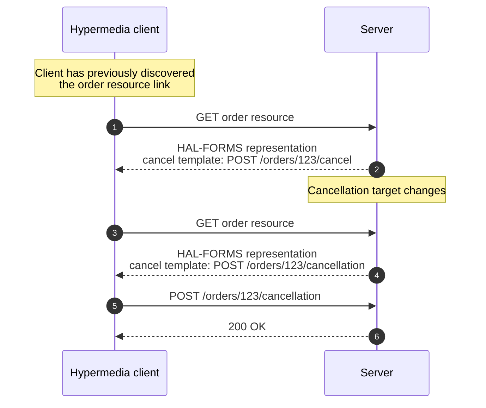

This article is part of a series on REST API design, questioning common REST conventions, the persistence of RPC-style
APIs, and what hypermedia actually requires from clients.



"Our API works. Our clients are happy. We can evolve it without problems."

I've encountered variations of this argument when challenging engineering teams about their REST API designs. It's a
reasonable response, at least initially. If the system works and consumers are satisfied, why question the architecture?

The interesting part begins when you ask what *evolving without problems* actually means.

Can the server change its resource structure without requiring client modifications? Can it introduce intermediate
workflow states without teaching every client about them?
Can it change an interaction's target or advertised submission details without coordinating releases across consumers?

Or does independent evolution mean introducing `/v2`, keeping `/v1` running, and giving clients another year to migrate?

Both approaches can keep an API operational. But they have different dependencies, and those dependencies determine what it costs to change the system.

Yet both are routinely called REST.

## Versioning as deferred maintenance

Consider a familiar HTTP API:

```http
GET /api/v1/orders/123
```

Clients depend on its URI structure, representations, and predefined operations. Eventually, the server needs to
introduce an incompatible change.

Rather than breaking existing consumers, the team introduces another version:

```http
GET /api/v2/orders/123
```

Existing clients continue using `/v1`. New clients adopt `/v2`.

Problem solved? 

The server now maintains two contracts. Some clients migrate immediately, others later, and some may never migrate.

Meanwhile, business requirements continue changing. Eventually, another incompatible change may introduce `/v3`.

Each supported version can carry its own compatibility requirements, tests, documentation, security considerations,
and operational obligations. The migration cost isn't confined to the server either.

Every independently maintained consumer may require development, testing, deployment, and coordination to move to the
new contract.

Versioning postpones the breaking change, but it doesn't remove the dependency that made the change breaking in the
first place.

The cost of maintaining compatibility can increase disproportionately as versions, consumers, and supported behaviors
accumulate. An organization can end up maintaining historical behavior long after the server has moved on.

And because these obligations accumulate gradually, their cost may be difficult to attribute to the original
architectural decisions.

The `/v1` prefix isn't itself the problem. It merely makes the version boundary explicit.
The underlying problem is that clients depend on interaction details controlled by the server. When those details
change, the clients must change with them, or the server must preserve the old contract.
Versioning manages that dependency. It doesn't eliminate it.

### Stability through compatibility isn't independent evolution

There's an important distinction between a server that can evolve without requiring client changes and one that can
evolve because it preserves every interface its clients depend on.

Both may appear stable to consumers, but the latter achieves stability by retaining compatibility obligations.
Versioning, compatibility layers, deprecation policies, and coordinated releases can make a tightly coupled
architecture operationally successful.

That doesn't mean the coupling has disappeared.
It means the organization has become good at managing it.



Figure: Operation-oriented clients depend on predefined interaction details. Hypermedia-driven clients discover
currently available interactions from server representations. Both remain dependent on compatible media types and domain
semantics.

In my earlier writing on REST API change strategies, I argued that versioning should be treated as a last-resort
safeguard rather than the default mechanism for managing change.

The objective is to facilitate change with minimal client impact while allowing the server to evolve independently.
That means designing for change before introducing version boundaries.

Clients shouldn't need to know how the server organizes related resources, how interaction targets are constructed, or
which server-controlled workflow rules determine the availability of an operation.

The server should be free to change its URI structure, relocate resources, modify resource granularity, and introduce
new state transitions without requiring coordinated client releases for every such change.

Hypermedia doesn't eliminate incompatible changes. Clients still depend on representation formats, relation semantics, and domain contracts. Changing those contracts can require client updates, regardless of how interactions are discovered. What hypermedia reduces is the need for clients to depend on server-controlled resource locations and independently reproduce the rules governing which interactions are available.

These are not incidental conveniences. They are consequences of the separation REST's uniform interface is intended to
establish.

## The RPC model never really went away

Before REST became the dominant terminology for HTTP APIs, SOAP and WSDL provided a standardized approach to describing
and consuming web services.

A developer could define service operations, generate client proxies, and invoke remote methods.

Conceptually, the client might look like this:

```java
orderService.cancelOrder(orderId);
```

Today, a developer can describe an HTTP API using OpenAPI, generate a client SDK, and write something remarkably
similar:

```java
orderApi.cancelOrder(orderId);
```

The technologies differ considerably. SOAP is a messaging protocol, WSDL describes service interfaces, and OpenAPI
describes HTTP APIs.

But the programming model often remains operation-oriented. OpenAPI can describe relationships between operations, 
but that doesn't mean generated clients discover and follow server-advertised interactions at runtime.

The client knows which operation to invoke, which parameters to supply, and how to interpret the response. The server
exposes a predefined interface that the client binds to.

This is familiar territory for developers accustomed to method invocation.
It also keeps the immediate cognitive load relatively low. Developers can reason about remote interactions much like
ordinary method calls, even though the underlying system is distributed.

REST requires a different interaction model. 
Instead of treating the server as a collection of remotely callable methods, the client interacts with resources
through representations and discovers available application state transitions at runtime.

Changing the transport from SOAP to HTTP, replacing XML with JSON, and organizing endpoints around resources doesn't
necessarily change the underlying programming model.

An RPC-style interaction doesn't become REST because the method call happens to use HTTP.
Yet that is effectively how much of the industry has come to understand REST API development.

## Application state is not resource state

This distinction is central to understanding why hypermedia matters.

Resource state is maintained by the server and communicated through representations. Application state concerns the
client's progression through a workflow.

A resource representation isn't merely a data carrier.
It can also communicate the interactions currently available to the client, using links and forms to advertise
possible state transitions.

Consider an order that can be cancelled.

A conventional client may know the cancellation endpoint in advance and independently determine when to invoke it.

A hypermedia-driven client instead examines the order representation and follows the advertised cancellation
interaction when available.

The server controls which transitions are offered. The client selects among those transitions according to its
application goals. This distinction becomes particularly important when business rules change.

If cancellation is no longer permitted in a particular state, the server can stop advertising that interaction.
The client doesn't need to reproduce the eligibility rules or construct the corresponding URI.

In my earlier writing, I described this as the server guiding the client through a possible path of state transitions,
determined by business rules and other server-side constraints.

When clients must independently reconstruct that path, server-controlled rules leak into the client tier.

Hypermedia doesn't eliminate the client's responsibility to understand domain semantics. A client still needs to know
what cancelling an order means and whether that action serves its purpose.

A hypermedia client isn't expected to start without any prior knowledge. It needs to understand the media types it
processes, the semantics of link relations, and the domain interactions relevant to its purpose. That knowledge is
different from depending on the server's URI structure or reconstructing its workflow rules.

## Hypermedia requires client participation

A server can implement hypermedia correctly and still fail to achieve the intended decoupling.
All it takes is a client that ignores the advertised controls.
This was one of the central observations in my earlier REST API change strategy:

*What does it help if the client just ignores everything and goes RPC style?*

Not much.

REST requires clients to participate in the interaction model.
That has concrete implications for client implementation.
Clients should discover and follow links rather than construct resource URIs. They should use advertised form
templates instead of assuming that invocation details are fixed.

They should inspect response media types and status codes, follow pagination links, and handle resources that are
relocated, deprecated, or no longer available.

They should also be prepared for representations to change in granularity.

A server may inline related information in one representation and provide links to it in another.
A client designed to handle both embedded and linked representations can retrieve information without depending
on one fixed resource structure.

The client also needs to tolerate information it doesn't understand. New links, properties, or available transitions
shouldn't automatically break an existing consumer.

That doesn't mean blindly accepting incompatible semantic changes. It means distinguishing information the client
needs from information it can safely ignore.

The same applies to HTTP itself.

Conditional requests, cache control, content negotiation, status codes, and standard method semantics provide
mechanisms that clients can use without inventing application-specific equivalents.

Treating HTTP merely as a transport for remote method calls discards much of that machinery.

A client that ignores hypermedia while relying on hardcoded endpoints isn't participating in the REST interaction
model, regardless of how the server describes itself.

## REST is not an API specification

REST, or Representational State Transfer, is an architectural style described by Roy Fielding in his doctoral
dissertation in 2000.

It defines constraints governing how components interact in a distributed hypermedia system.

Those constraints include client-server separation, stateless interactions, caching, a uniform interface, a layered
system, and optionally code-on-demand.

The uniform interface constraint includes resource identification, manipulation through representations,
self-descriptive messages, and hypermedia as the engine of application state.

REST doesn't prescribe URI conventions, JSON schemas, resource hierarchies, or business workflows.

It defines architectural constraints, not a specification for implementing an order management API.
The constraints are what produce the architectural properties associated with REST.

Remove a required constraint and the resulting architecture no longer conforms to the style.
An API either conforms to REST or it doesn't. There are no intermediate levels of REST conformance.

That says nothing about how well the API is implemented. Architectural classification and implementation quality are
different questions.
Roy Fielding makes the hypermedia requirement explicit in
[REST APIs must be hypertext-driven](https://roy.gbiv.com/untangled/2008/rest-apis-must-be-hypertext-driven).

The Richardson Maturity Model has arguably contributed to the confusion.
It describes levels of HTTP API design, progressing from a single endpoint through resources and HTTP methods to
hypermedia controls.

As a teaching model, it illustrates meaningful differences. But it also encourages an interpretation that REST
is something developers gradually achieve by adopting additional features.

A Level 2 API becomes almost REST, while Level 3 is considered a more mature implementation.

That is not how architectural constraints work. Even Fowler's discussion of the
[Richardson Maturity Model](https://martinfowler.com/articles/richardsonMaturityModel.html) notes that Fielding considers Level 3 a precondition of REST.

Using HTTP methods correctly doesn't compensate for omitting hypermedia. Neither does organizing endpoints around
resources or returning appropriate status codes.

Those practices can improve an HTTP API, but they don't replace REST's uniform interface.

The problem isn't that developers choose different architectural approaches.

It's that they routinely claim REST while discarding the constraints that distinguish it.

## Unlearning is harder than learning

I suspect the greatest obstacle to understanding REST isn't its technical complexity.

It's unlearning what developers have already been taught.

For years, developers have encountered tutorials, frameworks, and documentation describing REST APIs as collections
of HTTP endpoints using JSON, resource-oriented URLs, and appropriate HTTP methods.

Spring provides `@RestController`. OpenAPI provides a convenient way to describe operations. Client generators turn
those operations into callable methods.

The entire development workflow reinforces an operation-oriented mental model.

And because practically everyone follows similar conventions, the architectural classification is rarely questioned.

When I've challenged teams about missing REST constraints, the discussion often returns to established practices
rather than the architectural properties those constraints were intended to produce.

The reasoning becomes circular.

*This is how REST APIs are built because this is how everyone builds REST APIs.*

The herd provides its own justification.

There's also a difference between not knowing something and having learned something that actively interferes with
understanding it.

A developer unfamiliar with REST can learn its constraints.

A developer who has spent fifteen years building what everyone calls REST APIs may first need to accept that their
understanding of REST was incomplete.

That challenges established practices, previous architectural decisions, and potentially professional authority.

Recognizing that distinction doesn't mean an existing API should be redesigned. Changing an established architecture
still requires a business justification. The problem is when the alternative isn't even considered because everyone
assumes they're already implementing REST.

It's easier to dismiss hypermedia as unnecessary complexity than to question a programming model that has worked
reasonably well for years.

But familiarity and convenience don't establish architectural correctness. And widespread adoption doesn't
change the dependencies created by a particular design.

### Translating REST back into RPC

When developers encounter hypermedia, they may try to fit it into the existing programming model.

- How do I generate client methods from these links?
- How do I know every endpoint in advance?
- Why should I discover a URI when I already know it?

These questions reveal an assumption that the client should know the server's operations and invocation targets
beforehand.

Instead of examining how REST changes the interaction model, developers try to preserve the existing model while
adding hypermedia.

That can produce APIs containing links that clients never actually follow.
The representation changes. The architecture doesn't.

## The economics of convenience

Why is generating a client that binds itself to a server's predefined operations considered simple, while
implementing reusable infrastructure that reduces those dependencies is considered complex?

The answer depends on which costs we're counting.

An OpenAPI-generated client offers familiar methods, type information, IDE completion, and relatively little
infrastructure to implement manually.

The immediate development experience is convenient. But generating code doesn't eliminate dependencies. It automates
their implementation. Conventionally generated OpenAPI clients bind invocation details at build time, including
operations, request contracts, and interaction targets. Those dependencies remain even when the application code only
sees generated methods.

When those contracts change incompatibly, the client may need to be regenerated, adapted, tested, and redeployed.
Alternatively, the server must continue supporting the old contract.
The complexity hasn't disappeared. Some of it has been deferred into future compatibility maintenance.



When an interaction's URI changes, a client bound to the old target needs that target to remain supported or the client
to be updated. A hypermedia-driven client can discover the new target through the current representation.

A hypermedia-driven client requires infrastructure for interpreting representations, discovering links, selecting
interaction templates, and invoking advertised controls.

That work is visible during implementation. But much of it is reusable.

A HAL/HAL-FORMS client doesn't need an entirely new link-processing mechanism for every resource. The same
infrastructure can support different interactions and applications.

The application-specific parts remain, particularly relation semantics and business decisions.
The machinery for discovering and invoking controls can be shared.

Libraries such as Spring HATEOAS provide some of that infrastructure, but higher-level client support remains limited,
particularly for interpreting HAL-FORMS templates and selecting application-specific interactions.

This is an important economic distinction.

The cost of implementing reusable client infrastructure is incurred early and can be amortized across applications that
share compatible interaction models.

For long-lived APIs with independently maintained consumers, compatibility obligations can accumulate across years of
server changes. Whether the cost of reducing those dependencies outweighs the additional client infrastructure depends
on how frequently those interactions change and how many consumers must accommodate them.

Not all of those costs are attributable to client-server coupling. But the compatibility obligations created by
static interaction contracts are a recurring expense that should be included in the architectural comparison.

If you control both the client and the server and can coordinate their changes and deployments cheaply, the dependencies 
REST is designed to reduce may not justify the additional infrastructure. A tighter, operation-oriented protocol such 
as gRPC may be a better fit.

Hypermedia-driven interaction discovery becomes particularly valuable when you don't control the client lifecycle.
Without it, every change to an interaction detail the client has hardcoded means either coordinating with clients 
or supporting the old contract, and that cost comes back to the server.

An implementation can be simple precisely because it pushes complexity elsewhere, deferring the cost and
distributing it across the system's lifetime.

REST addresses part of that problem by reducing the information clients need to know about server-controlled
interactions.

This doesn't eliminate the cost of implementing clients. It changes which costs are paid repeatedly and which
dependencies are avoided altogether.

## When terminology stops communicating architecture

Terminology matters because architects and developers use it to communicate design decisions.

When someone describes an API as REST, that should tell us something about its interaction model and the constraints
governing client-server communication.

If the same term describes both a hypermedia-driven distributed application and a collection of predefined HTTP
operations, it no longer distinguishes those architectures.

This makes it harder to reason about the consequences of architectural decisions.

Suppose one team implements REST's constraints and achieves a high degree of independent client-server evolution.
Another team examines the implementation, adopts its resource-oriented URLs and HTTP conventions, but retains
statically bound clients and predefined workflows.

Both implementations are called REST.
What has the second team actually learned from the first?
The most consequential architectural distinction has disappeared into a shared label.

When the second implementation later requires API versioning and coordinated client migrations, those costs may be
treated as normal REST API maintenance.

The relationship between the omitted constraints and the resulting coupling is no longer apparent.

One response has been to introduce another label: *hypermedia API*.

But hypermedia is part of REST's uniform interface, not a replacement name for the architectural style. An API using
hypermedia doesn't necessarily satisfy REST's other constraints either.

Calling conformant REST implementations *hypermedia APIs* effectively leaves the term REST to implementations that don't
follow its defining constraints.

The term RESTful doesn't resolve the ambiguity. It's often used to describe HTTP APIs that follow familiar REST
conventions without implementing all of REST's constraints. But calling an API RESTful doesn't tell us whether its
clients actually discover and follow hypermedia controls.

Why should the architecture need another name because the industry has adopted its terminology for something else?

An HTTP API is an HTTP API. 

An operation-oriented HTTP API may be exactly what the system needs. But there's no reason to call it REST when a
more accurate description is available.

*"We're building a resource-oriented HTTP API with an OpenAPI contract and generated clients. We don't need runtime
hypermedia discovery because we can coordinate changes to our clients and server."*

That's a defensible architectural decision. It describes both the implementation and the coupling the team has chosen to
accept.

REST already has a name.

And that brings me back to the team whose API works, whose clients are happy, and whose server can supposedly
evolve without problems.

How many historical API versions are they still maintaining? How many consumers depend on them? And what would it
actually take to retire the oldest one?