*Originally published in April 2022. Updated October 2026.*

Finding the best route between two points sounds simple until the map contains hundreds of intersections, roads with
different travel costs, and areas that should be avoided altogether. This is the *shortest-path problem*: given a graph
and a cost for traversing each edge, find a path whose **total cost is minimal**.

In this article, we'll use a small graph to explore two classic shortest-path algorithms: **Dijkstra's algorithm** and
**A* search**. We'll start with the fundamentals of graph theory and briefly explore breadth-first search (BFS),
depth-first search (DFS), and Bellman–Ford before examining Dijkstra and A* step by step.

If you're already familiar with graph theory, feel free to jump directly to the algorithm walkthroughs. The later
sections cover heuristic selection, Java implementation details, and a practical pathfinding example from Arma 3.

The accompanying [shortest-path demo project](https://github.com/cloudneutral/shortestpath) includes visualizations
and implementations.

## Why pathfinding matters in games

Imagine an AI-controlled squad moving from one position to another without unnecessary exposure to enemy fire. The
shortest geometric route may cross a minefield or a defended position. A longer route along a road might be faster,
safer, or both.

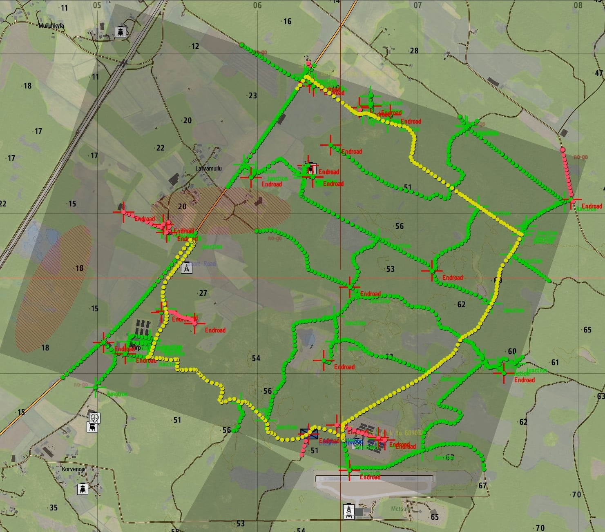

A route planner can assign costs to road segments and intersections based on distance, terrain, vehicle accessibility,
or danger. The algorithm then minimizes the **sum of those costs**, not necessarily the physical distance.

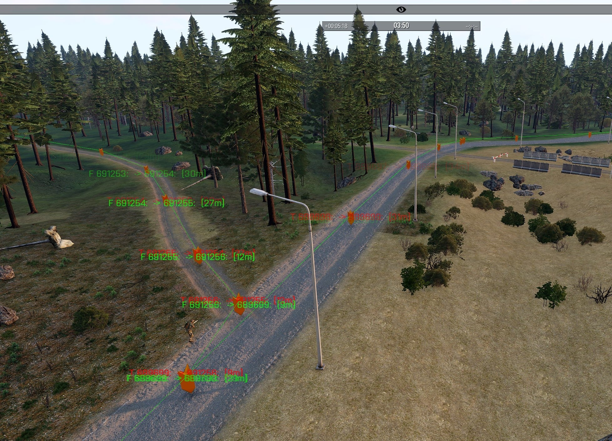

*Screenshots from Arma 3.*

## Graph theory primer

A **graph** consists of **vertices** (also called nodes) and **edges** connecting them. In a road network, intersections
can be vertices and road segments can be edges.

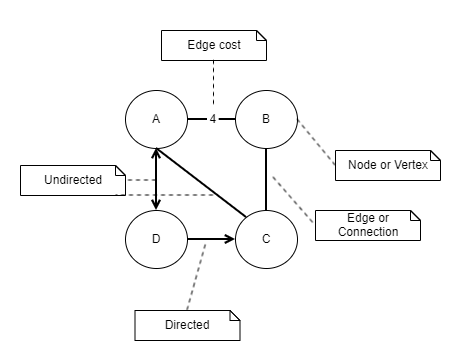

An edge may be **directed** (travel is allowed only one way) or **undirected** (travel is allowed both ways). A graph is
**cyclic** if it contains a cycle; otherwise, it is **acyclic**. A **tree** is a connected, acyclic, undirected graph.

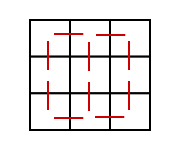

A grid is another useful graph representation: cells are vertices and permitted moves between neighboring cells are
edges. Four-way and eight-way movement produce different edge sets.

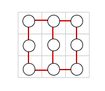

### Edge weights and path costs

For a weighted graph, each edge has a **weight** representing the cost of traversing it. A route's cost is the sum of
its edge weights:

```text
cost(A → B → D → F) = w(A,B) + w(B,D) + w(D,F)
```

Weights can represent travel time, distance, fuel consumption, or a composite measure. Their meaning matters: a
straight-line distance is a useful estimate of remaining cost only when the edge-weight model makes that estimate a
lower bound.

## The algorithms at a glance

| Algorithm        | How it explores                                              | Shortest-path guarantee                             | Typical use                                     |
|------------------|--------------------------------------------------------------|-----------------------------------------------------|-------------------------------------------------|
| **BFS**          | Expands by number of edges from the start                    | Yes, for unweighted or equal-weight edges           | Grid movement with uniform costs                |
| **DFS**          | Explores a branch before backtracking                        | No                                                  | Traversal, connectivity, maze exploration       |
| **Dijkstra**     | Expands the vertex with the lowest known cost from the start | Yes, with nonnegative edge weights                  | Weighted routes, shortest paths from one source |
| **A\***          | Expands the vertex with the lowest `g + h` estimate          | Yes, with appropriate heuristic and search handling | Goal-directed pathfinding                       |
| **Bellman–Ford** | Repeatedly relaxes edges                                     | Yes, absent reachable negative cycles               | Graphs with negative edge weights               |

All these algorithms traverse graphs, but they answer somewhat different questions. DFS is not a shortest-path algorithm
in the usual sense; BFS is optimal only under uniform edge costs; and Bellman–Ford trades speed for the ability to
handle negative weights and detect reachable negative cycles.

### Breadth-first search (BFS)

BFS visits vertices in layers: first those one edge away, then two edges away, and so on. A FIFO queue ensures that the
first time a vertex is discovered, BFS has found a path to it using the fewest edges.

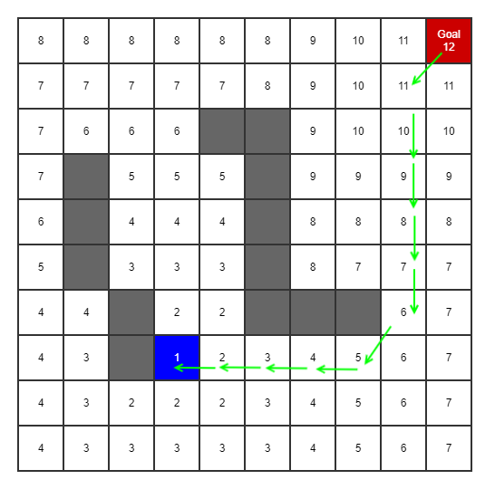

BFS can stop when it discovers the goal. It does **not** have to visit every vertex, but it may explore a large portion
of the graph. For unequal edge costs, the fewest edges need not be the cheapest route.

### Depth-first search (DFS)

DFS follows one branch until it reaches a dead end, then backtracks and explores alternatives. It is useful for graph
traversal, reachability, and some maze-solving strategies, but the first path it finds is not necessarily the shortest.

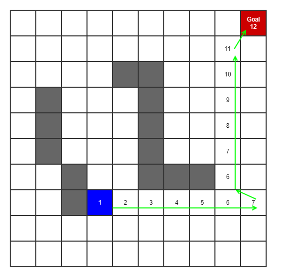

DFS can reach a goal quickly on some graphs and take much longer on others; it is not generally faster than BFS.

## Dijkstra's algorithm

Dijkstra's algorithm, developed by Edsger W. Dijkstra in the 1950s, solves the single-source shortest-path problem for
graphs with **nonnegative edge weights**. It works by maintaining the cheapest currently known distance from the start
to each vertex.

Consider the following graph. Our starting vertex is `A`, our destination is `F`, and the red numbers indicate edge
weights.

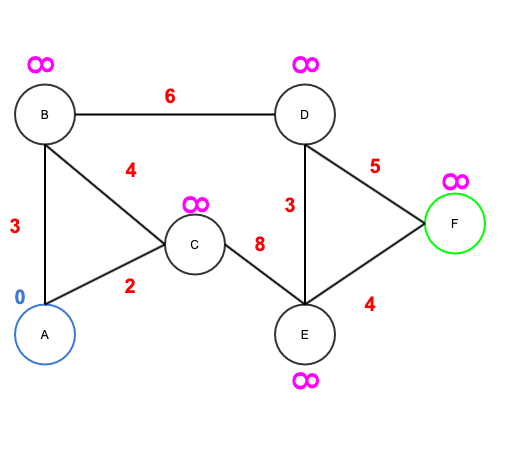

The relevant edges and weights are:

```text
A—B: 3    A—C: 2    B—C: 4
B—D: 6    C—E: 8    D—E: 3
D—F: 5    E—F: 4
```

We'll track two things for each vertex:

- **Tentative distance** `dist[v]`: the best cost found so far from `A` to `v`.
- **Predecessor** `prev[v]`: the vertex immediately before `v` on that best-known path.

Initially, `dist[A] = 0`, all other distances are infinity, and no predecessors are set. At each step, select the
**unsettled vertex with the smallest tentative distance**, relax its outgoing edges, and then settle it.

*Relaxing* an edge `u → v` means checking whether `dist[u] + weight(u,v)` improves `dist[v]`. If it does, update both
the distance and predecessor.

### Step 1: Start at A

`A` has distance `0`. Its neighbors are `B` and `C`:

```text
dist[B] = min(∞, 0 + 3) = 3    prev[B] = A
dist[C] = min(∞, 0 + 2) = 2    prev[C] = A
```

Settle `A`. Among the remaining vertices, `C` has the smallest tentative distance (`2`), so it is next.

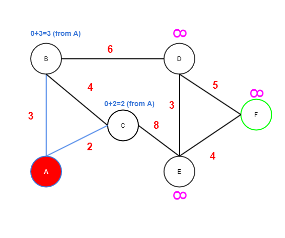

### Step 2: Expand C

From `C`, consider `B` and `E`:

```text
via C to B = 2 + 4 = 6    (keep dist[B] = 3)
via C to E = 2 + 8 = 10   (set dist[E] = 10, prev[E] = C)
```

Settle `C`. The smallest unsettled tentative distance now belongs to `B` (`3`).

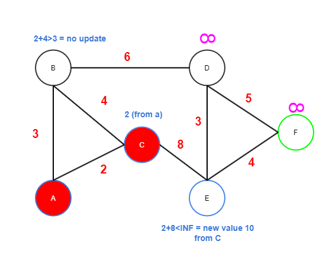

### Step 3: Expand B

`B` has a distance of `3`. Its relevant unsettled neighbor is `D`:

```text
via B to D = 3 + 6 = 9    (set dist[D] = 9, prev[D] = B)
```

Settle `B`. Next is `D` (`9`), ahead of `E` (`10`).

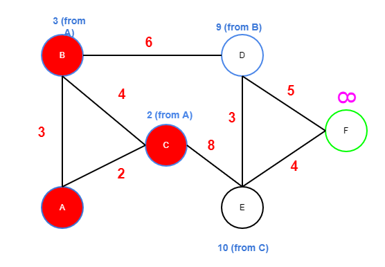

### Step 4: Expand D

From `D`, consider `E` and `F`:

```text
via D to E = 9 + 3 = 12   (keep dist[E] = 10)
via D to F = 9 + 5 = 14   (set dist[F] = 14, prev[F] = D)
```

**We have discovered a route to `F`, but we cannot stop yet.** A tentative distance is not final until that vertex is
selected as the minimum-distance unsettled vertex.

Settle `D`. The next vertex is `E` (`10`), not `F` (`14`).

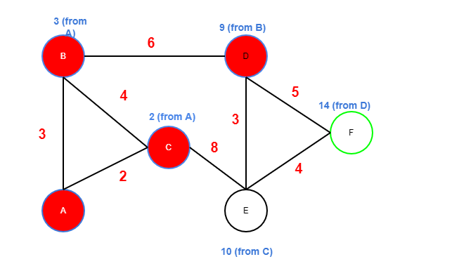

### Step 5: Expand E, then settle F

`E` offers another route to `F`:

```text
via E to F = 10 + 4 = 14
```

This ties the existing distance of `14`, so we can keep `prev[F] = D`. Settle `E`. Now `F` is the unsettled vertex with
the smallest tentative distance. When we remove `F` from the priority queue, its distance is final and we may stop.

### Reconstruct the shortest path

Follow predecessor pointers backward from `F`:

```text
F ← D ← B ← A
```

Reverse the sequence:

```text
A → B → D → F
Total cost = 3 + 6 + 5 = 14
```

There is also an equally cheap path:

```text
A → C → E → F
Total cost = 2 + 8 + 4 = 14
```

Dijkstra's algorithm may return either, depending on how equal-cost alternatives and predecessor updates are handled.

### Why Dijkstra works

With nonnegative weights, once a vertex has the smallest tentative distance among all unsettled vertices, no route
through the remaining unsettled vertices can improve it. That is why its distance can be finalized. This reasoning
breaks down when negative-weight edges are allowed.

## A* search: adding direction to the search

Dijkstra's algorithm expands outward according to the known cost from the start. If we care about **one destination**,
we can often avoid exploring irrelevant areas by estimating which vertices are closer to the goal.

A* does this with three values:

```text
g(n) = cheapest known cost from the start to n
h(n) = estimated remaining cost from n to the goal
f(n) = g(n) + h(n)
```

Dijkstra prioritizes `g(n)`; A* prioritizes `f(n)`. **The heuristic changes exploration order, not actual edge weights
or accumulated path cost.** When relaxing an edge, always calculate the new `g` from the current vertex's `g`, never
from its `f`.

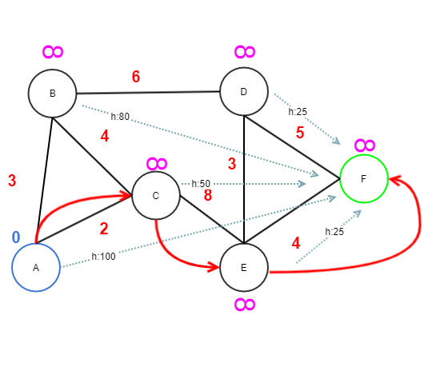

*The original illustration shows the idea of heuristic estimates. The numerical walkthrough below uses a separate,
admissible heuristic table rather than the historical values printed in that image.*

### Choosing a heuristic

An **admissible** heuristic never overestimates the true remaining cost. A **consistent** heuristic additionally
satisfies `h(u) ≤ w(u,v) + h(v)` for every edge `u → v`, with `h(goal) = 0`.

Consistency is useful for a graph-search implementation with a closed set: when a vertex is settled, its best path is
already known. With an admissible but inconsistent heuristic, an implementation may need to reopen previously closed
vertices to preserve optimality.

Euclidean (straight-line) distance can be a good heuristic when edge costs represent distance and no route can cost less
than its straight-line length. If costs measure time, danger, or another quantity, the heuristic must be scaled or
designed for that cost model.

### Common A* heuristics

The effectiveness of A* depends heavily on the heuristic function. For spatial graphs, a common approach is to estimate
the remaining cost using the geometric distance between the current node and the destination.

Several distance functions are commonly used, depending on the movement model and how edge costs are defined.

#### Manhattan distance

Suitable for movement restricted to four directions (horizontal and vertical), where each step has equal cost.

```text
h = |dx| + |dy|
```

Manhattan distance measures the total horizontal and vertical displacement. It is an exact distance on an obstacle-free,
four-direction grid with unit movement costs.

#### Euclidean distance

The straight-line distance between two points.

```text
h = sqrt(dx² + dy²)
```

Euclidean distance is useful for spatial graphs where edge weights represent geometric distance. It provides a lower
bound on the actual travel distance because no route between two points can be shorter than the straight-line distance.

It is also applicable to grid-based movement, although more specialized heuristics may provide tighter estimates.

#### Chebyshev distance

Suitable for eight-direction movement where diagonal and straight moves have equal cost.

```text
h = max(|dx|, |dy|)
```

Because diagonal movement reduces both horizontal and vertical displacement simultaneously, the minimum number of steps
is determined by the larger coordinate difference.

#### Octile distance

Suitable for eight-direction movement where straight moves cost `1` and diagonal moves cost `√2`.

```text
h = max(|dx|, |dy|) + (√2 - 1) × min(|dx|, |dy|)
```

Octile distance gives the exact shortest-path cost on an obstacle-free, eight-direction grid with unit straight-move
costs and diagonal costs of √2. It therefore provides a tighter heuristic than Euclidean distance for this movement
model.

#### Choosing the right heuristic

Here, `dx` and `dy` represent the differences in horizontal and vertical coordinates between the current node and the
destination.

The appropriate heuristic depends on the graph's connectivity and how movement costs are defined:

- **Manhattan:** Four-direction movement with uniform costs.
- **Euclidean:** Geometric distance in spatial graphs.
- **Chebyshev:** Eight-direction movement with equal straight and diagonal costs.
- **Octile:** Eight-direction movement with diagonal costs proportional to geometric distance.

These formulas assume the movement costs described above. If actual movement costs differ, the heuristic must be scaled
or adapted accordingly.

In practice, a more accurate estimate of the remaining cost can significantly reduce the number of vertices A* explores,
provided the heuristic remains admissible.

### A* walkthrough on the same graph

Let's reuse vertices `A` through `F` and **the same edge weights** as in the Dijkstra example. For this demonstration,
choose these consistent, admissible estimates of the remaining cost to `F`:

| Vertex | `h(n)` | True cheapest remaining cost |
|--------|-------:|-----------------------------:|
| A      |     10 |                           14 |
| B      |     11 |                           11 |
| C      |      8 |                           12 |
| D      |      5 |                            5 |
| E      |      4 |                            4 |
| F      |      0 |                            0 |

These values are illustrative estimates, not distances inferred from the drawing's coordinates. Notice that `h(B) = 11`
and `h(D) = 5` are exact, while `h(C) = 8` is a lower bound.

#### Step 1: Expand A

Start with `g(A) = 0` and `f(A) = 0 + 10 = 10`. Relax its edges:

```text
B: g = 3, h = 11, f = 14
C: g = 2, h =  8, f = 10
```

A* chooses `C` next because its `f` is smaller. Dijkstra also chose `C`, but because its `g` was smaller.

#### Step 2: Expand C

Calculate tentative **actual** path costs from `g(C) = 2`:

```text
B via C: tentative g = 2 + 4 = 6   (keep B's g = 3)
E via C: tentative g = 2 + 8 = 10  (set g(E) = 10)

E: g = 10, h = 4, f = 14
```

Now `B` and `E` both have `f = 14`. A* may choose either. To illustrate goal-directed search, suppose our tie-breaking
rule chooses `E`.

#### Step 3: Expand E

From `E`, we can reach `D` and `F`:

```text
D via E: g = 10 + 3 = 13, h = 5, f = 18
F via E: g = 10 + 4 = 14, h = 0, f = 14
```

The open set contains `B` (`f = 14`), `F` (`f = 14`), and `D` (`f = 18`). If ties favor the goal, `F` is selected next
and the search ends with:

```text
A → C → E → F
Total cost = 2 + 8 + 4 = 14
```

The other optimal path, `A → B → D → F`, also costs `14`. A* did **not** make the route through `B` more expensive; it
simply explored the route through `C` first.

#### Step 4: What if ties are resolved differently?

If A* selects `B` before `F`, it can discover `D` with `g(D) = 9`, improving the earlier value of `13`. The eventual
result is still optimal. Which equal-cost path is reconstructed depends on tie-breaking and predecessor-update rules.

This small graph doesn't demonstrate a dramatic speedup, and that's fine. A* becomes particularly useful on large maps
where a good heuristic directs the search toward the goal and avoids much of the area Dijkstra would otherwise explore.

### When A* behaves like Dijkstra

Set `h(n) = 0` for every vertex:

```text
f(n) = g(n) + 0 = g(n)
```

A* then uses the same priority as Dijkstra. A poorly chosen heuristic may provide little benefit; an overestimating
heuristic can sacrifice the shortest-path guarantee.

## Game example: road-network pathfinding in Arma 3

The practical motivation for this project was pathfinding over an Arma 3 road network. Road segments become vertices,
and connectivity between nearby segments becomes graph edges. Once the road graph has been constructed, a shortest-path
algorithm can search for a route between two positions.

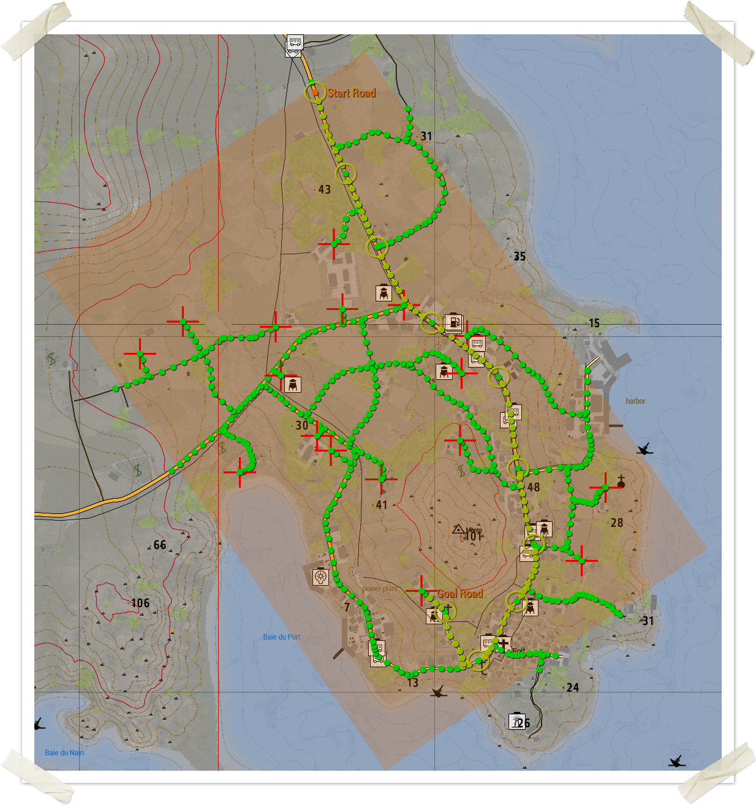

In this example, the green markers show road segments in the graph. A preparatory traversal discovers the connected road
network; the pathfinding search then operates on that graph. Those are two separate operations: graph construction and
shortest-path search.

A [recorded Arma 3 demonstration](https://github.com/cloudneutral/shortestpath/blob/main/shortestpath-arma3/pathfinding-themovie.mp4)
is available in the project repository.

### Dijkstra in Arma script (SQF)

The original implementation uses hash tables for tentative distances and predecessors, an unvisited collection, and
helper functions to retrieve neighbors and edge weights. Its central relaxation step is:

```sqf
private _currentDist = [_distanceHash, _current] call CBA_fnc_hashGet;
private _unvisitedNeighbors = [_edges, _visitedList, _current] call FUNC(unvisitedNeighbors);

{
    private _neighbor = _x;
    private _edgeWeight = [_edges, _current, _neighbor] call FUNC(edgeWeight);
    private _totalDist = _currentDist + _edgeWeight;
    private _tentativeDist = [_distanceHash, _neighbor] call CBA_fnc_hashGet;

    if (_totalDist < _tentativeDist) then {
        [_distanceHash, _neighbor, _totalDist] call CBA_fnc_hashSet;
        // Update predecessor and add neighbor to the unvisited set.
    };
} forEach _unvisitedNeighbors;
```

The interesting part is the same as in the mathematical walkthrough: **only a cheaper actual path changes a vertex's
tentative distance**. The full [Arma 3 implementation](https://github.com/cloudneutral/shortestpath) includes the
supporting graph and predecessor bookkeeping.

One implementation detail matters: if the goal is selected as the lowest-cost unsettled vertex, early termination is
safe. Merely encountering the goal as a neighbor is not sufficient.

## Java implementation: Dijkstra and A*

The companion [Java project](https://github.com/cloudneutral/shortestpath) demonstrates shortest-path algorithms through
a graphical visualization of the search process.

Although Dijkstra and A* use different strategies for selecting the next vertex to explore, they share the same
fundamental relaxation rule: update a vertex's best-known distance whenever a cheaper path is discovered.

The key difference is how vertices are prioritized:

- **Dijkstra:** Uses the accumulated path cost `g(n)`.
- **A\*:** Uses `f(n) = g(n) + h(n)`, combining the accumulated cost with an estimate of the remaining distance.

The following Java snippets illustrate these principles independently of the repository's implementation.

### The shared relaxation rule

For either algorithm, the core update should look conceptually like this:

```java
double tentativeG = current.g() + edgeWeight(current.node(), neighbor);

if (tentativeG < bestG.getOrDefault(neighbor, Double.POSITIVE_INFINITY)) {
    bestG.put(neighbor, tentativeG);
    predecessor.put(neighbor, current.node());

    double f = tentativeG + heuristic(neighbor, goal);

    openSet.add(new QueueEntry<>(neighbor, tentativeG, f));
}
```

The distinction between `g` and `f` is crucial. The edge relaxation compares **`g` values**; the priority queue orders
by **`f`** for A*, or by `g` when the heuristic is zero.

### A Java `PriorityQueue` pitfall

Java's `PriorityQueue` does not automatically reorder an entry when the mutable object used as its sort key changes. If a vertex's `g` or `f` is modified after it has entered the queue, the queue's heap ordering may become invalid.

A robust approach is to enqueue **immutable snapshots** and discard entries whose `g` is no longer current:

```java
record QueueEntry<N>(N node, double g, double f) {}

PriorityQueue<QueueEntry<N>> openSet = new PriorityQueue<>(
    Comparator.comparingDouble(QueueEntry<N>::f)
);

bestG.put(start, 0.0);
openSet.add(new QueueEntry<>(start, 0.0, heuristic(start, goal)));

while (!openSet.isEmpty()) {
    QueueEntry<N> entry = openSet.poll();

    // A better route was found after this snapshot was queued.
    if (entry.g() > bestG.getOrDefault(entry.node(), Double.POSITIVE_INFINITY)) {
        continue;
    }

    // With a consistent heuristic (or Dijkstra), the first valid
    // removal of the goal is the optimal stopping point.
    if (entry.node().equals(goal)) {
        break;
    }

    for (N neighbor : neighbors(entry.node())) {
        double tentativeG = entry.g() + edgeWeight(entry.node(), neighbor);

        if (tentativeG < bestG.getOrDefault(neighbor, Double.POSITIVE_INFINITY)) {
            bestG.put(neighbor, tentativeG);
            predecessor.put(neighbor, entry.node());

            openSet.add(new QueueEntry<>(
                neighbor,
                tentativeG,
                tentativeG + heuristic(neighbor, goal)
            ));
        }
    }
}
```

This is an **illustrative algorithm fragment**, not a complete standalone class: it assumes `bestG`, `predecessor`,
`neighbors`, `edgeWeight`, `heuristic`, `start`, and `goal` are defined. It also assumes nonnegative edge weights and,
for A*'s early-exit guarantee, a consistent heuristic. The immutable-entry approach avoids mutating keys already inside
the priority queue.

The [original Java demo source](https://github.com/cloudneutral/shortestpath) provides a practical demonstration of
pathfinding and its visualization. The examples above illustrate the underlying algorithmic principles and safe
priority-queue handling rather than reproducing the project's source code.

## Choosing an algorithm

For a small, unweighted graph, BFS is usually the simplest shortest-path solution. For weighted graphs with nonnegative
costs, Dijkstra is a reliable default. When you have a specific destination and a meaningful lower-bound estimate, A*
can greatly reduce the search space. If negative edge weights are required, Bellman–Ford is one option; Dijkstra and
ordinary A* assumptions no longer apply.

For a game map, the algorithm is only part of the design. The graph representation, edge-cost model, heuristic, and
frequency of route recalculation often matter just as much as the choice between Dijkstra and A*.

## Conclusion

Dijkstra and A* solve the same fundamental problem: finding a lowest-cost route through a graph. Dijkstra prioritizes
the **cost already incurred**; A* combines that cost with an **estimate of what remains**. With a suitable heuristic and
correct queue handling, A* can reach the same optimal answer while examining fewer vertices.

The important details are easy to miss in a high-level description: a discovered goal is not necessarily settled,
heuristic estimates are not actual travel costs, and priority queues must reflect updated priorities correctly. Once
those distinctions are clear, the algorithms become much easier to reason about—and to apply to real road networks,
games, and other routing problems.

**Source and demos:** [github.com/cloudneutral/shortestpath](https://github.com/cloudneutral/shortestpath)