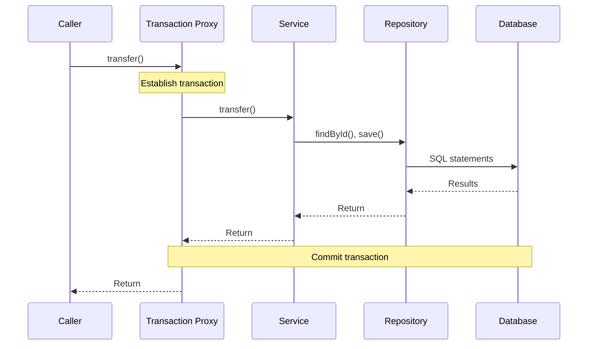
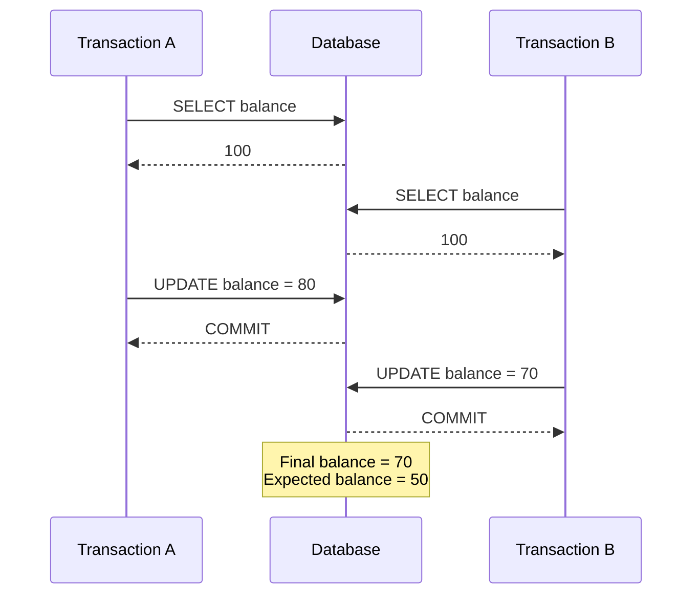
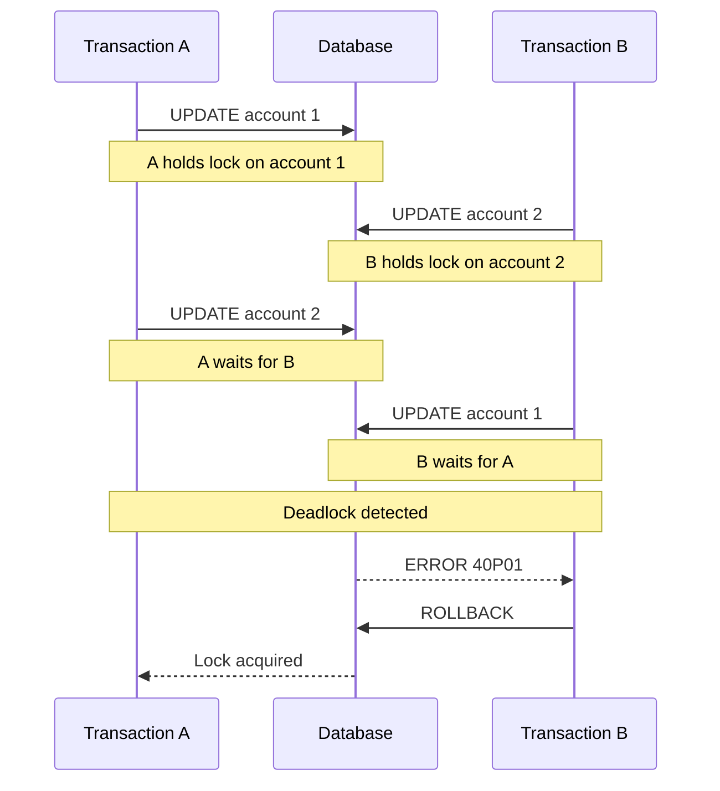
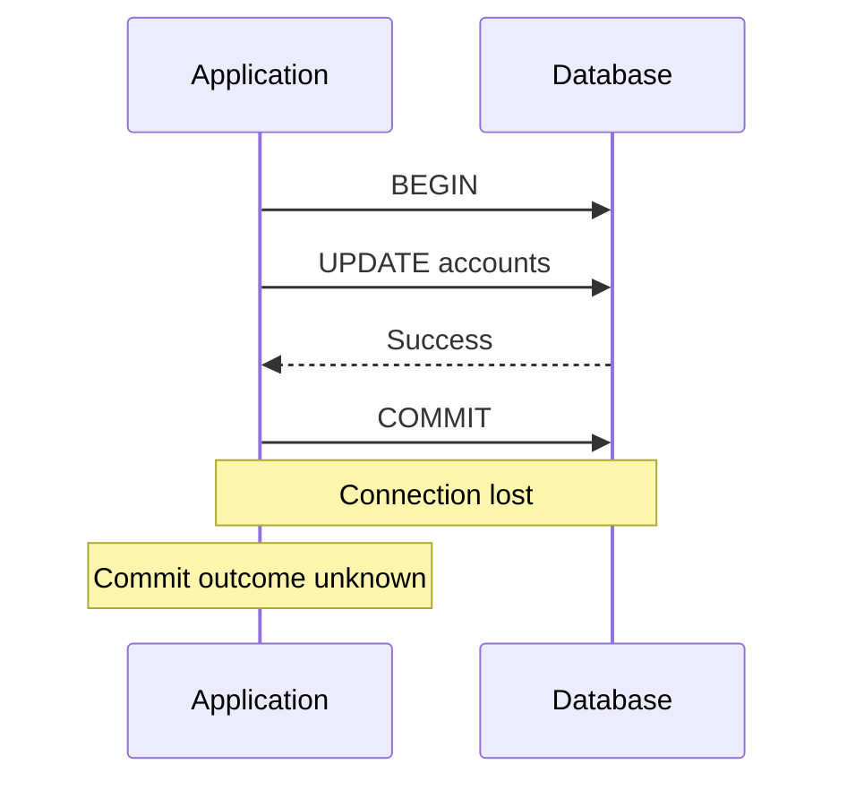
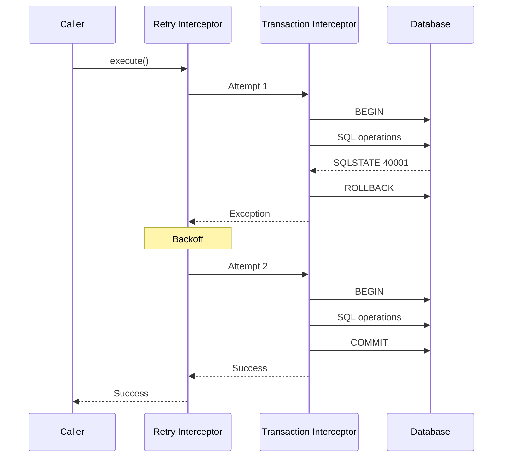

This article is the first in a series about data access with Spring Data.

<!--more-->



This article covers a selection of transaction management patterns, pitfalls, and implementation details when using
Spring Boot with Spring Data JPA or JDBC. The topics include transaction boundaries, connection management, isolation
and concurrency control, read-only transactions, and handling transaction failures.

Each section addresses a separate concern, using PostgreSQL as the primary reference database. The examples examine how
Spring's transaction abstractions interact with database behavior, particularly where transaction boundaries,
concurrency, or failure handling are not immediately obvious.

## Transaction Boundaries and Scope

A database transaction holds resources for its lifetime. Depending on the operations performed, these may include
connections, locks, transaction metadata, and database versions required by concurrent readers.

Long-running transactions increase contention and can reduce throughput, particularly in applications with many
concurrent requests.

### Transaction Ownership and Propagation

Consider a service that transfers money between accounts:

```java
@Service
@RequiredArgsConstructor
public class TransferService {

    private final AccountRepository accounts;

    @Transactional(propagation = Propagation.REQUIRES_NEW)
    public void transfer(
            Long sourceId,
            Long targetId,
            BigDecimal amount) {

        Account source = accounts.findById(sourceId)
                .orElseThrow();

        Account target = accounts.findById(targetId)
                .orElseThrow();

        source.debit(amount);
        target.credit(amount);

        accounts.save(source);
        accounts.save(target);
    }
}
```

Both account modifications participate in the same transaction. If either operation fails with an exception that
triggers rollback, neither modification is committed.

The service method provides a transaction boundary around a complete database operation. Both updates commit or roll
back together, but this example demonstrates atomicity, not concurrency correctness. Under PostgreSQL's default
`READ COMMITTED` isolation, concurrent transfers can still produce lost updates if balances are read and overwritten
without locking or version checks. The concurrency section covers ways to prevent this.

Spring's default `REQUIRED` propagation starts a transaction when none exists or participates in an existing one. This
is convenient, but it also means transaction ownership depends on the calling context. A service method that starts its
own transaction when called directly can silently become part of a larger transaction when called by another service.

For stateless services working against a single transactional database, one architectural convention is to distinguish
transaction-owning application services from services that participate in an existing transaction. Transaction owners
use `REQUIRES_NEW` to establish an independent transaction boundary. Participating control services use `MANDATORY` to
require an existing transaction without creating one. Repositories perform persistence operations within the boundary
established by the application service.

This is an architectural convention, not a requirement of Spring. `REQUIRED` can also start a transaction. The reason
for using `REQUIRES_NEW` here is to make transaction ownership independent of the caller rather than allowing a service
to join another transaction implicitly.

Transaction-owning services should not invoke other transaction-owning services from within an active transaction.
`REQUIRES_NEW` does not reject that composition: it suspends the existing transaction and starts another, which can
commit independently and may require another database connection. Such calls violate the intended separation of
responsibilities and require architectural checks beyond propagation settings to prevent.

Custom meta-annotations can make the convention visible in application code. For example, `@TransactionBoundary` can
identify a transaction-owning application service and map to `REQUIRES_NEW`, while `@TransactionMandatory` can identify
a participating service and map to `MANDATORY`. They convey intended responsibilities but do not change Spring's runtime
propagation behavior.

```java
@Inherited
@Documented
@Retention(RetentionPolicy.RUNTIME)
@Target({ElementType.TYPE, ElementType.METHOD})
@Transactional(propagation = Propagation.REQUIRES_NEW)
public @interface TransactionBoundary {
    /**
     * Indicates whether the transaction is read-only.
     * Actual enforcement depends on the transaction manager.
     */
    @AliasFor(annotation = Transactional.class, attribute = "readOnly")
    boolean readOnly() default false;
}
```

Participating services use a corresponding annotation:

```java
@Inherited
@Documented
@Retention(RetentionPolicy.RUNTIME)
@Target({ElementType.TYPE, ElementType.METHOD})
@Transactional(propagation = Propagation.MANDATORY)
public @interface TransactionMandatory {
}
```

Illustrated usage in the transfer example above:

```java
@TransactionBoundary
public void transfer(
        Long sourceId,
        Long targetId,
        BigDecimal amount) {
    // Transfer implementation
}
```

Then in some collaborating service:

```java
@TransactionMandatory
public void updateBalance(...) {
// Requires an existing transaction
}
```

Spring Data JPA repository methods may already have transactional behavior. Inherited CRUD methods in
`SimpleJpaRepository` are transactional, with read operations typically marked read-only. Spring Data JDBC has its own
repository transaction configuration. Repository defaults therefore need attention if only designated application
services should be allowed to create transactions.

### External Calls and Transaction Scope

Performing remote operations while holding a database transaction open can unnecessarily extend transaction duration:

```java
@Transactional
public void processOrder(Order order) {
    orderRepository.save(order);

    paymentClient.authorize(order);

    inventoryClient.reserve(order);
}
```

The database transaction remains active while waiting for external services.

This creates several problems:

- Database connections may remain occupied during network calls, particularly after SQL statements have been executed.
- Locks may be held longer than necessary.
- External operations cannot be rolled back by the database.
- Timeouts can leave the outcome of remote operations uncertain.

One way to shorten the database transaction is to perform the external operation before entering the transactional
service:

```java
public void processOrder(Order order) {
    paymentClient.authorize(order);

    orderTransactionService.createOrder(order);
}
```

```java
@Service
@RequiredArgsConstructor
public class OrderTransactionService {

    private final OrderRepository orders;

    @Transactional(propagation = Propagation.REQUIRES_NEW)
    public void createOrder(Order order) {
        orders.save(order);
    }
}
```

This reduces transaction duration but changes the failure scenarios. If payment authorization succeeds and the database
transaction fails, the application must handle an authorization without a corresponding order. Reversing the order of
operations creates a different failure window. Neither arrangement makes the overall workflow atomic.

For workflows requiring reliable coordination between database changes and message publication, the transactional outbox
pattern is generally more appropriate.

See [Best-Effort One-Phase Commit and the Dual-Write Problem](/posts/best-effort-one-phase-commit-and-the-dual-write-problem/)
for a discussion of these tradeoffs.

### Spring Transaction Proxies

Spring typically implements declarative transactions using AOP proxies.

When a caller invokes a transactional method through the Spring proxy, the transaction interceptor establishes or joins
a transaction before invoking the target method.

The transaction interceptor commits when the method completes successfully or rolls back when an exception requires it.



The diagram represents the logical transaction lifecycle. Depending on the transaction manager and persistence provider,
acquiring a physical database connection and starting the corresponding database transaction may be deferred until the
connection is needed.

An important consequence of proxy-based transaction management is that **self-invocation does not pass through the proxy**.

```java
@Service
public class TransferService {

    public void execute() {
        transfer(); // Bypasses transactional proxy
    }

    @Transactional(propagation = Propagation.REQUIRES_NEW)
    public void transfer() {
        // ...
    }
}
```

Here, the annotation on `transfer()` does not establish a new transaction when called directly from `execute()`.

Moving the transactional operation into another Spring-managed service avoids this problem.

For programmatic control, Spring also provides `TransactionTemplate`:

```java
transactionTemplate.executeWithoutResult(status -> {
    accountRepository.debit(sourceId, amount);
    accountRepository.credit(targetId, amount);
});
```

This can be useful when transaction boundaries must be controlled independently of method boundaries.

## Transaction and Connection Management

### Explicit SQL Transactions

An explicit SQL transaction groups multiple statements:

```sql
BEGIN;

UPDATE accounts
SET balance = balance - 100
WHERE id = 1;

UPDATE accounts
SET balance = balance + 100
WHERE id = 2;

COMMIT;
```

If an error occurs before committing, the transaction can be rolled back:

```sql
ROLLBACK;
```

In PostgreSQL, a statement error generally leaves an explicit transaction in an aborted state. Subsequent statements
fail until the transaction is rolled back, unless the application uses savepoints to recover.

### JDBC Auto-Commit

JDBC connections default to auto-commit mode unless configured otherwise.

With auto-commit enabled, each statement executes as its own transaction when no explicit transaction is active.

```java
connection.setAutoCommit(true);

statement.executeUpdate(
    "UPDATE accounts SET balance = balance - 100 WHERE id = 1"
);

statement.executeUpdate(
    "UPDATE accounts SET balance = balance + 100 WHERE id = 2"
);
```

These statements are not atomic as a group. The first may commit even if the second fails.

Disabling auto-commit allows several statements to participate in one transaction:

```java
connection.setAutoCommit(false);

try {
    // Execute statements

    connection.commit();
} catch (SQLException e) {
    connection.rollback();
    throw e;
}
```

Spring transaction managers normally handle these operations on behalf of the application.

### Connection Acquisition with Spring Data

In a typical Spring Boot application, transaction management involves several components:

- Spring's transaction manager determines transaction boundaries.
- The JPA provider or Spring Data JDBC performs persistence operations.
- HikariCP manages the underlying JDBC connection pool.
- The database provides isolation, locking, and commit semantics.

With JPA, the persistence provider may defer acquiring a physical database connection until it is needed. SQL execution
may also be deferred until the persistence context is flushed.

Consequently, the beginning of a Spring transaction does not necessarily correspond to an immediate SQL `BEGIN` statement.

The exact behavior depends on the persistence provider, transaction manager, connection handling mode, and connection
pool configuration.

When using Hibernate with a connection pool configured to disable auto-commit, the following settings may be relevant:

```yaml
spring:
  datasource:
    hikari:
      auto-commit: false

  jpa:
    properties:
      hibernate:
        connection:
          provider_disables_autocommit: true
```

The Hibernate property tells the provider that connections are already configured with auto-commit disabled. With
compatible connection handling, this can allow Hibernate to defer physical connection acquisition. It is not the same
mechanism as wrapping a data source in `LazyConnectionDataSourceProxy`.

**These settings must agree.** Setting `provider_disables_autocommit` to `true` without actually disabling auto-commit
can cause incorrect transaction behavior.

This is a configuration choice rather than a universal optimization. It should be evaluated against the application's
connection handling and transaction requirements.

## Transaction Isolation and Concurrency

Isolation determines how concurrent transactions interact and which intermediate or committed changes they can observe.

### Isolation Levels

The SQL standard defines four isolation levels:

| Isolation level | General behavior |
|---|---|
| Read Uncommitted | Permits the weakest isolation |
| Read Committed | Prevents dirty reads |
| Repeatable Read | Provides stronger consistency across repeated reads |
| Serializable | Requires results equivalent to some serial execution |

Database implementations differ in how they provide these guarantees.

PostgreSQL maps READ UNCOMMITTED to READ COMMITTED because it does not permit dirty reads. Oracle supports neither READ
UNCOMMITTED nor REPEATABLE READ, while MySQL InnoDB supports all four standard isolation levels, including dirty reads
under READ UNCOMMITTED.

The SQL standard's isolation levels do not capture every possible concurrency anomaly. For a more detailed examination
of their limitations, see [A Critique of ANSI SQL Isolation Levels](https://blog.acolyer.org/2016/02/24/a-critique-of-ansi-sql-isolation-levels/),
a review of the influential 1995 paper by Berenson et al.

`SERIALIZABLE` is intended to provide the strongest isolation guarantee, but its implementation and guarantees vary
between databases. In PostgreSQL, concurrent transactions may encounter serialization failures and require retries.
These failures are a consequence of enforcing serializability, not a violation of it.

Spring exposes isolation settings through `@Transactional`:

```java
@Transactional(
        propagation = Propagation.REQUIRES_NEW,
        isolation = Isolation.SERIALIZABLE
)
public void transfer(
        Long sourceId,
        Long targetId,
        BigDecimal amount) {
    // ...
}
```

The setting applies when Spring starts a new physical transaction. A method joining an existing transaction generally
inherits that transaction's isolation level.

### Lost Updates

Consider two concurrent transactions updating the same account balance.

Both read an initial balance of 100.

Transaction A subtracts 20, while transaction B subtracts 30.

If each calculates a new balance in application code and writes it without concurrency protection, the final balance
may reflect only one update.



Under PostgreSQL's default `READ COMMITTED` isolation, this can happen when an application reads a value and later
writes an absolute replacement value.

Several approaches can prevent it.

**Atomic SQL updates** avoid the separate read-modify-write cycle:

```sql
UPDATE accounts
SET balance = balance - 20
WHERE id = 1 AND balance >= 20;
```

The application must check the affected row count to determine whether the operation succeeded.

**Pessimistic locking** explicitly locks a row before modifying it:

```sql
SELECT balance FROM accounts WHERE id = 1 FOR UPDATE;
```

Spring Data JPA supports pessimistic locking through `@Lock`:

```java
@Lock(LockModeType.PESSIMISTIC_WRITE)
@Query("SELECT a FROM Account a WHERE a.id = :id")
Optional<Account> findForUpdate(Long id);
```

**Optimistic locking** detects conflicting updates using a version column:

```java
@Entity
public class Account {

    @Id
    private Long id;

    @Version
    private Long version;

    private BigDecimal balance;
}
```

The JPA provider checks the entity's version when updating it. If another transaction has modified the entity in the
meantime, the update fails with an optimistic locking exception.

```sql
UPDATE accounts
SET balance = ?, version = version + 1
WHERE id = ? AND version = ?;
```

These mechanisms have different performance and contention characteristics. The appropriate choice depends on the access
pattern, expected conflicts, and business invariants.

## Read-Only Transactions

Spring supports read-only transaction declarations:

```java
@Transactional(
        propagation = Propagation.REQUIRES_NEW,
        readOnly = true
)
public AccountSummary getAccount(Long id) {
    return accountRepository.findById(id)
            .map(AccountSummary::from)
            .orElseThrow();
}
```

The meaning of `readOnly = true` depends on the transaction manager and persistence provider.

With Hibernate as the JPA provider, Spring can optimize read-only transactions by adjusting the flush mode and disabling
dirty checking for loaded entities.

This may improve performance for read-heavy workloads involving managed entities.

However, **Spring's read-only declaration is not necessarily enforced by the database**.

A read-only transaction can therefore be a performance hint rather than a strict guarantee that no modifications occur.

PostgreSQL provides database-enforced read-only transactions:

```sql
BEGIN TRANSACTION READ ONLY;

SELECT * FROM accounts WHERE id = 1;

COMMIT;
```

Operations that attempt prohibited modifications fail.

Spring's `DataSourceTransactionManager` can be configured to enforce read-only transactions at the database level, where
supported, through `setEnforceReadOnly(true)`.

This behavior should not be assumed for JPA transaction managers.

For applications requiring strict protection against writes, database privileges and explicit database-level read-only
enforcement provide stronger guarantees than application annotations alone.

## Transaction Failures and Retries

Transactions can fail for reasons unrelated to application validation.

Common examples include serialization conflicts, deadlocks, constraint violations, timeouts, and lost database
connections.

Correct failure handling requires distinguishing errors that can be retried from errors whose outcome is uncertain.

### Serialization Failures and Deadlocks

PostgreSQL reports serialization failures using SQLSTATE `40001`.

These can occur under `SERIALIZABLE` isolation when concurrent transactions cannot be committed in a serializable order.
PostgreSQL can also report `40001` under `REPEATABLE READ`, including for concurrent update conflicts.

Deadlocks are reported using SQLSTATE `40P01`.

For example:



PostgreSQL detects the deadlock and aborts one transaction.

Both serialization failures and deadlocks may be transient. Retrying the complete transaction can succeed once the
conflicting activity has completed.

The important requirement is that **the retry must start a new transaction**.

Retrying an individual SQL statement inside a transaction that has already been aborted is generally insufficient.

### Ambiguous Commit Outcomes

A more difficult failure occurs when the connection is lost during commit.

Consider:



The application cannot determine from the connection failure alone whether the transaction committed.

Two outcomes are possible:

1. The database committed successfully, but the acknowledgment was lost.
2. The transaction did not commit.

Blindly retrying a non-idempotent operation can therefore execute it twice.

This distinction is particularly important for payments, transfers, and other operations that must not be duplicated.

The usual solution is to associate the logical operation with a stable identifier and make duplicate execution
detectable.

For example:

```sql
CREATE TABLE transfers (
    id UUID PRIMARY KEY,
    source_account BIGINT NOT NULL,
    target_account BIGINT NOT NULL,
    amount NUMERIC(19, 2) NOT NULL
);
```

The transfer identifier can serve as an idempotency key when it is inserted in the same transaction as the account
updates.

A retry using the same identifier must not apply the transfer again.

The database's uniqueness constraint provides the foundation for duplicate detection, while application logic determines
how an existing operation is handled.

See [Designing Idempotent REST APIs](/posts/designing-idempotent-rest-apis/) for a more detailed treatment of
idempotency keys and request semantics.

### Transaction Retry Boundaries

Spring Retry can be used to retry transient transaction failures.

A critical detail is the ordering of retry and transaction interceptors.

The retry interceptor must execute outside the transaction interceptor so that every attempt receives a fresh
transaction. The retry scope must include the commit, since a serialization failure can be reported when committing.



One way to make the boundaries explicit is to separate the retrying service from the transactional service:

```java
@Service
@RequiredArgsConstructor
public class TransferRetryService {

    private final TransferService transfers;

    @Retryable(
        retryFor = {
            CannotSerializeTransactionException.class,
            DeadlockLoserDataAccessException.class
        },
        maxAttempts = 3,
        backoff = @Backoff(
                delay = 100,
                multiplier = 2,
                maxDelay = 2000,
                random = true
        )
    )
    public void transfer(TransferCommand command) {
        transfers.execute(command);
    }
}
```

```java
@Service
@RequiredArgsConstructor
public class TransferService {

    private final AccountRepository accounts;

    @Transactional(propagation = Propagation.REQUIRES_NEW)
    public void execute(TransferCommand command) {
        // Execute the complete transfer
    }
}
```

Each retry invokes the transactional service through its Spring proxy. With `REQUIRES_NEW` propagation, every attempt
starts an independent transaction. In this example the retrying service is non-transactional; invoking it from an
existing transaction would violate the transaction ownership convention described earlier. For serialization failures
and deadlocks, the failed transaction is rolled back before the retry interceptor initiates another attempt.

Actual exception types depend on the persistence framework, transaction manager, and exception translation. Retry
policies should be tested against the database errors the application encounters.

The example also assumes that the transaction does not perform irreversible external side effects.

Exponential backoff reduces retry frequency under contention, but deterministic delays can cause concurrent transactions
to retry at approximately the same time. This may lead to repeated conflicts, particularly during periods of high
concurrency.

Adding jitter introduces randomness into retry delays, spreading competing transactions over time and reducing
synchronized retry attempts. Spring Retry supports randomized exponential backoff through `@Backoff(random = true)`.

Retries should remain bounded, with a maximum delay and a limited number of attempts. Jitter reduces the probability of
repeated contention but does not eliminate the underlying conflicts.

### Rollback Rules

By default, Spring rolls back declarative transactions for unchecked exceptions and `Error` subclasses.

Checked exceptions do not trigger rollback unless configured.

For example:

```java
@Transactional(
    rollbackFor = BusinessException.class
)
public void execute() throws BusinessException {
    // ...
}
```

This distinction matters when service methods use checked exceptions to report failures that should invalidate the
transaction.

Another subtle case is catching an exception inside a transactional method:

```java
@Transactional
public void process() {
    try {
        repository.performOperation();
    } catch (DataAccessException e) {
        log.warn("Operation failed", e);
    }
}
```

Catching the exception does not necessarily restore the transaction to a usable state.

In PostgreSQL, a statement error can leave the underlying transaction aborted. Spring may also have marked the
transaction rollback-only.

If the method subsequently returns normally, the transaction may still fail during commit.

Failures that invalidate the unit of work should generally propagate to the transaction boundary, where rollback and
retry decisions can be made consistently.

## References

- [Spring Framework: Transaction Management](https://docs.spring.io/spring-framework/reference/data-access/transaction.html)
- [Spring Data JPA: Transactionality](https://docs.spring.io/spring-data/jpa/reference/jpa/transactions.html)
- [Spring Data JDBC: Transaction Management](https://docs.spring.io/spring-data/relational/reference/jdbc/transactions.html)
- [PostgreSQL: Transaction Isolation](https://www.postgresql.org/docs/current/transaction-iso.html)
- [PostgreSQL: Explicit Locking](https://www.postgresql.org/docs/current/explicit-locking.html)
- [PostgreSQL: Error Codes](https://www.postgresql.org/docs/current/errcodes-appendix.html)
- [A Critique of ANSI SQL Isolation Levels](https://blog.acolyer.org/2016/02/24/a-critique-of-ansi-sql-isolation-levels/)

Part of the [Data Access](/series/data-access/) series.